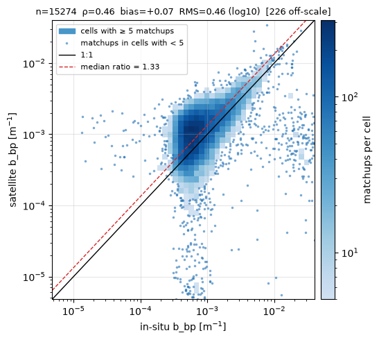
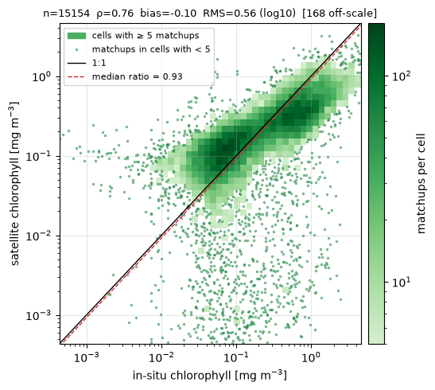
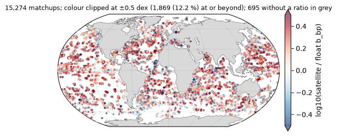
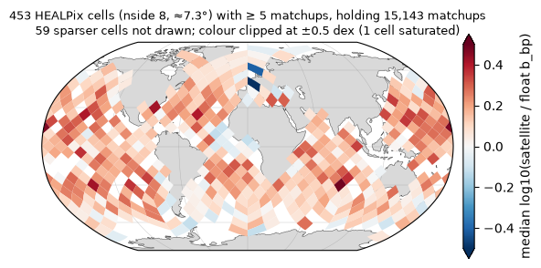
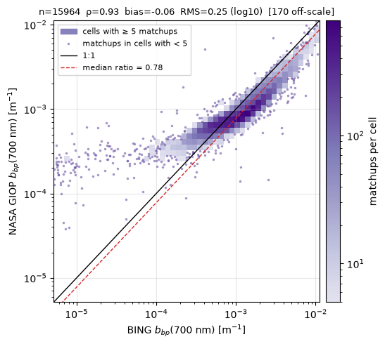
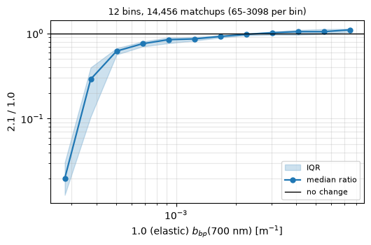
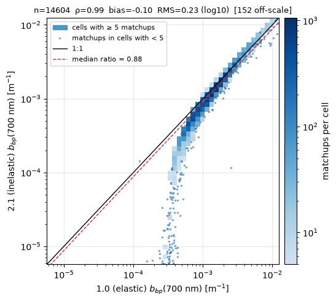
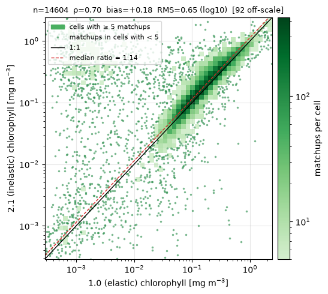
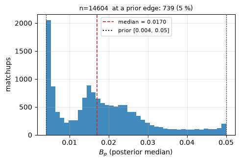

Satellite vs float comparisons
==============================

15,971 matchups — shown as static summary figures (the interactive per-point scatter is suppressed at this scale to keep the committed site small; per-matchup values are in the downloadable summary table on the :doc:`Downloads <downloads>` page).

   Satellite vs float ``b_bp`` (700 nm), log-log; axes span the central 99 % of the values. Filled cells where ≥ 5 matchups fall in a cell, individual points elsewhere; 226 matchups lie outside the axes and are counted in the statistics. The dashed line is the median ratio; the solid line is 1:1. 0 failed retrievals (0.00 %, ``b_bp`` > 1 m⁻¹) excluded.

   Satellite vs float chlorophyll, log-log; axes span the central 99 % of the values. Filled cells where ≥ 5 matchups fall in a cell, individual points elsewhere; 168 matchups lie outside the axes and are counted in the statistics. The dashed line is the median ratio; the solid line is 1:1.

   Matchup locations (one dot per matchup); colour = log10(satellite / float ``b_bp``), symmetric about 0 and clipped at a fixed ±0.5 dex (a factor of 3.2 either way). The 1,869 matchups (12.2 % of the 15,274 with a ratio) at or beyond ±0.5 dex saturate to the end colours. The 695 matchups without a ratio (no float ``b_bp``, or a failed retrieval) are grey; 0 failed retrievals (0.00 %, ``b_bp`` > 1 m⁻¹) excluded.

   Median log10(satellite / float ``b_bp``) per HEALPix cell (nside 8, ≈ 7° cells); only cells holding ≥ 5 matchups are drawn (453 cells, 15,143 matchups; 59 sparser cells left out). The same scale as the dot map: colour = log10(satellite / float ``b_bp``), symmetric about 0 and clipped at a fixed ±0.5 dex (a factor of 3.2 either way); saturated (median at or beyond ±0.5 dex): 1 of the 453 drawn cells. 0 failed retrievals (0.00 %, ``b_bp`` > 1 m⁻¹) excluded.

BING vs NASA GIOP (L2 IOP)
--------------------------

The same PACE overpasses, retrieved two ways: **BING** (this project) against NASA's own **GIOP** retrieval, read from the operational ``PACE_OCI_L2_IOP`` product at the *same pixel* used for the BING fit. See the :doc:`Methods <methods>` page for the product details and provenance.

**Wavelength note:** NASA reports ``b_bp`` at **442 nm** while BING's headline ``b_bp`` is at **700 nm** (chosen to match the float ``BBP700``). NASA's value is shifted to 700 nm with GIOP's own per-pixel power-law slope ``bbp_s``: ``b_bp(700) = b_bp(442) × (442/700)^bbp_s`` (the credible bounds scale by the same factor), so the comparison below is at one wavelength. 14.6 % of the 15,971 slopes sit at GIOP's ceiling of 2.0 — such a slope is a pinned fit rather than a measurement, so those pixels' 700 nm values are the least constrained. For continuity with the previous release, which compared the two as stored, the unadjusted median NASA(442)/BING(700) ratio on the same matchups is 1.8.

- n = 15964; median NASA(700)/BING(700) ratio = 0.778 (IQR 0.648–1.03); Spearman ρ = 0.927; log10 offset = -0.0578, RMS = 0.253; BING 0 failed retrievals (0.00 %, ``b_bp`` > 1 m⁻¹) excluded.

   NASA GIOP ``b_bp`` shifted to 700 nm vs BING ``b_bp`` (700 nm), log-log; axes span the central 99 % of the values. Filled cells where ≥ 5 matchups fall in a cell, individual points elsewhere; 170 matchups lie outside the axes and are counted in the statistics. The dashed line is the median ratio; the solid line is 1:1. BING 0 failed retrievals (0.00 %, ``b_bp`` > 1 m⁻¹) excluded.

1.0 vs 2.1 — elastic vs inelastic retrieval
-------------------------------------------

The **same 14,604 matchups**, fitted twice: the 1.0 results come from the frozen v1 release, the 2.1 results from this one. Rows are paired on matchup **and pixel**, so a difference below is a difference in the retrieval, not in which patch of ocean was looked at. See the :doc:`Methods <methods>` page for the two-database provenance.

**What changed in 2.0.** The 1.0 fits used the *elastic* Gordon radiative-transfer model: ``Rrs`` is produced by absorption and elastic scattering alone. 2.0 re-fits the same spectra with an **inelastic** forward model:

- **Radiative-transfer backend** — ``robust_hybrid`` (a neural-network emulator of a full RT solution) replaces the analytic ``gordon`` parameterisation.
- **Raman scattering** — water molecules re-emit absorbed blue light at longer wavelengths; included.
- **Chlorophyll fluorescence** — the ~685 nm phytoplankton emission line, at quantum yield ``phi_C = 0.02``; included.
- **CDOM fluorescence** — available in the model but **off** in this run, so none of the results below include it.
- **Free ``B_p``** — the backscatter phase-function parameter, held fixed in 1.0, is a sixth fitted parameter in 2.0 with a uniform prior over ``[0.004, 0.05]``.

The **fit window is unchanged** at 400–700 nm. The red edge (713/719 nm, where Raman and fluorescence are strongest) was evaluated and deliberately left out: on a 97-matchup diagnostic sample Rrs(719) is negative or noise-dominated on **44 %** of matchups, so including it would feed the inelastic terms mostly noise.

**What changed in 2.1.** 2.1 re-fits the same spectra as 2.0 — each replayed bit-identically from its 2.0 chain file — with **one** change: the forward model is evaluated at the geometry the PACE L2 AOP ``Rrs`` is normalized to, a sun at zenith and a nadir view, (θ_s, θ_v, Δφ) = (0, 0, 0), with the inelastic terms' downwelling irradiance taken at θ_s = 0. 2.0 used each pixel's observed L1B angles, but NASA's processing (``l2gen``, ``brdf_opt = 7``) distributes an exact-normalized reflectance, so the 2.0 model was evaluated at a different geometry from the data it fitted. The backend, the inelastic terms, the priors (with the 2.0.1 ceilings), the free ``B_p`` and the fit window are unchanged. The observed angles stay in the database as pixel metadata. In this release, over the 15,971 fits paired on matchup and pixel, the median ``b_bp`` (700 nm) ratio of 2.1 to 2.0 (2.0.1 where re-fitted) is **1.17**; the shift grows with the solar zenith angle, and the full comparison is in `geometry_rerun.md <https://github.com/ocean-colour/PAB/blob/main/versions/v2.1/geometry_rerun.md>`__. The 1.0-vs-2.1 differences below therefore include that geometry change as well as the inelastic physics.

- **b_bp(700 nm)** — n = 14,604; median 2.1/1.0 ratio = 0.877 (IQR 0.784–0.944); Spearman ρ = 0.991; log10 offset = -0.0968, RMS = 0.228; 0 failed retrievals (0.00 %, ``b_bp`` > 1 m⁻¹) excluded.

- **chlorophyll** — n = 14,604; median 2.1/1.0 ratio = 1.14 (IQR 0.977–1.35); Spearman ρ = 0.698; log10 offset = 0.185, RMS = 0.649.

Result: the inelastic correction is a clear-water effect
~~~~~~~~~~~~~~~~~~~~~~~~~~~~~~~~~~~~~~~~~~~~~~~~~~~~~~~~

The single median ratio understates and overstates by turns, because the shift is a strong, monotonic function of how much backscatter there is to begin with. Split by the 1.0 ``b_bp`` into terciles, the median 2.1/1.0 ratio runs clearest third 0.75; middle third 0.87; most-scattering third 0.96 (tercile edges 0.000975 and 0.00156 m⁻¹), and it keeps going at the extremes: below 0.0002 m⁻¹ (n = 52) the ratio is ~0.018, i.e. 2.1 retrieves some **55 times less** backscatter than 1.0.

This is the expected behaviour of the physics, not an artifact. Raman scattering and chlorophyll fluorescence contribute a roughly fixed radiance; what varies is how much *elastic* signal sits underneath them. In clear water the elastic contribution is small, so the inelastic terms are a large fraction of ``Rrs`` — and the 1.0 model, which has no inelastic terms at all, could only explain that radiance by inventing particulate backscatter. 2.1 attributes it to the processes that actually produce it, and the retrieved ``b_bp`` drops accordingly. In productive water the elastic signal dominates, the inelastic terms are a small correction, and the two versions converge — the most-scattering tercile differs by only 4 %.

The practical consequence: the headline ratio is a population median and **not** a correction factor to apply to a single retrieval. Which end of this curve a matchup sits on matters more than the median does.

   The 2.1/1.0 ``b_bp`` ratio against the 1.0 value, with the interquartile band. The curve rises from ~0.02 in the clearest water to ~1.1 in the most scattering: the inelastic correction is large where the elastic signal is weak and small where it is strong. Bins with fewer than 20 matchups are not plotted; 0 failed retrievals (0.00 %, ``b_bp`` > 1 m⁻¹) excluded.

(The Chl figures are also the ``A_ph`` figures: BING's chlorophyll is a fixed rescaling of the fitted phytoplankton absorption amplitude, ``Chl = A_ph / 0.05582``, so every ratio statistic is identical. Both columns are in the downloadable table.)

14,604 paired matchups — shown as static figures (the interactive per-point scatter is suppressed at this scale to keep the committed site small).

   2.1 (inelastic) vs 1.0 (elastic) ``b_bp`` (700 nm), log-log, same matchup and same pixel. Filled cells where ≥ 5 matchups fall in a cell, individual points elsewhere; 152 matchups lie outside the axes and are counted in the statistics. The dashed line is the median ratio; the solid line is 1:1. 0 failed retrievals (0.00 %, ``b_bp`` > 1 m⁻¹) excluded.

   2.1 (inelastic) vs 1.0 (elastic) chlorophyll, log-log, same matchup and same pixel. Filled cells where ≥ 5 matchups fall in a cell, individual points elsewhere; 92 matchups lie outside the axes and are counted in the statistics. The dashed line is the median ratio; the solid line is 1:1.

   Posterior-median ``B_p`` across the 14,604 2.1 fits. ``B_p`` was **fixed** in 1.0, so there is no 1.0 counterpart to scatter it against. The dotted lines are the uniform prior's bounds; the fraction within 1 % of an edge is given in the panel title.

**The prior is doing real work at both ends.** The posterior medians are **bimodal**, with mass against *both* bounds of the uniform ``[0.004, 0.05]`` prior: 5.1 % within 1 %, 12.4 % within 2 %, 22.0 % within 5 % of a bound. The 1st percentile sits at the floor and the 99th at the ceiling. A pile-up at a bound means the data preferred a value the prior forbade, so for those fits the bound — not the spectrum — sets ``B_p``. The bounds are physically motivated and have been kept, but the headline ``B_p`` distribution should be read as *censored at both ends* rather than as a free measurement.
