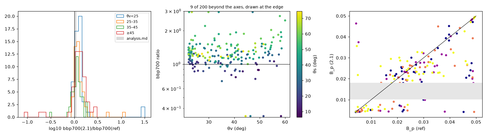
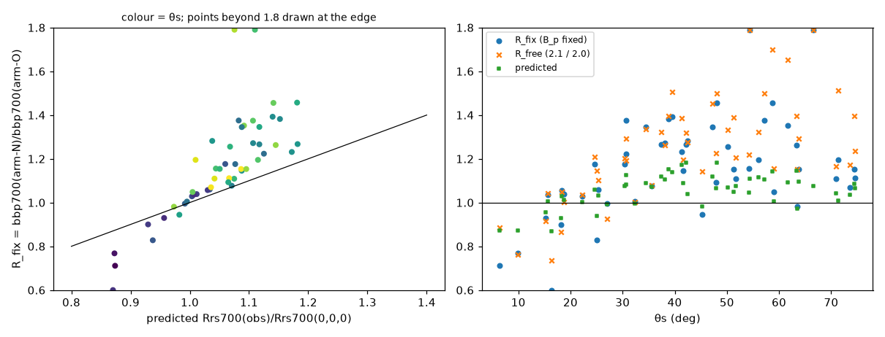

# v2.1 geometry re-run: the slice gate

*Task 2 of `claude_prompts/v2/build_v2_1_rerun.md`; 2026-11-15. The
full-population numbers are added in Task 4.*

v2.1 fits every v2 BING matchup with the `robust_hybrid` forward model
evaluated at the geometry the PACE L2 AOP `Rrs` is normalized to,
(θ_s, θ_v, Δφ) = (0, 0, 0), with the inelastic `Ed` at θ_s = 0. The 2.0 and
2.0.1 fits used each pixel's observed L1B angles. Everything else is the
2.0.1 configuration, and each spectrum is replayed bit-identically from its
2.0 chain NPZ. This page is the go/no-go evidence from a 200-matchup slice
plus a 50-matchup fixed-`B_p` arm.

## 1. What was run

| | |
|---|---|
| Image | `pab:2.1.0`. SHAs: PAB `1f4b770`, bing `9acbe53`, ocpy `5261256`, remote_sensing `2b85c65`, retrieve-or-bust `78d7de7` |
| Pod | `nautilus/v21_slice_job.yaml`, 50 CPU / 100 Gi, 2026-11-15 01:27–02:03 UTC |
| Main | `slice_200.csv`: 50 per θ_v band (<25, 25–35, 35–45, ≥45°), basin × season round-robin, 10 of the 51 2.0.1 re-fits; `FitConfig()` (2.1) |
| Arm | `bp_arm_50.csv` (13/13/12/12 per band, no re-fits). `B_p` **fixed at 0.014**, the value the analysis.md prediction used, under both geometries: arm-N = `FitConfig(fit_Bp=False, Bp_value=0.014)`, arm-O = `FitConfig.v2_0_1(fit_Bp=False, Bp_value=0.014)` |
| Spectra | replayed from `/data/v2/fit_chains/<2.0 fit_id>.npz`, 200/200 present |
| Reference | the stored 2.0 fit, or the 2.0.1 fit for the 10 re-fits, read from the **workstation** v2 DB (`9503015b…`) |
| Outputs | `$PAB_DATA_DIR/v2.1_slice/{main,arm_norm,arm_obs}/` (DBs + 300 chains, sha-checked on pull-back) |
| Analysis | `analyze_slice.py` → `slice_summary.json`, `slice_table.csv`, `arm_table.csv`, `fig_slice_ratios.png`, `fig_bp_arm.png` |

Two deviations from Plan §3:
- The 50 `ztt_slice` fits could not be re-used. Their sample list was lost
  in a `/tmp` wipe.
- The PVC `/data/v2/pab.db` (`7d44e1f3…`) is a pre-2.0.1 copy with no 2.0.1
  rows. That is harmless here, because the references come from the
  workstation DB. It confirms that Task 3 must stage the live DB first.

## 2. Gate quantities

| Trigger (V7) | Threshold | Slice | |
|---|---|---|---|
| median `bbp700(2.1)/bbp700(ref)` | [0.98, 1.20] | **1.212** [16–84 %: 1.003–1.507] | **just outside**; see §3 |
| … population-reweighted (θ_s) | | 1.139 | inside |
| … population-reweighted (θ_v band × basin) | | 1.149 | inside |
| failures | ≤ 2 % | **0 / 200** (0 / 100 in the arm) | ok |
| median s/fit | ≤ 300 s | **244 s** steady state (from `created`; first result after 302 s of spawn + compile) | ok |
| χ²_red | | median ratio 2.1/ref **0.974** [0.88–1.06]; median 0.440 → 0.415 | slightly better |
| acceptance | | median 0.337 → 0.329; Δ −0.007 [−0.040, +0.021] | unchanged |

Other quantities (median ratio 2.1/ref, [16–84 %]):

| | all | θ_v < 25 | 25–35 | 35–45 | ≥ 45 |
|---|---|---|---|---|---|
| `bbp700` | 1.212 [1.00, 1.51] | 1.239 | 1.177 | 1.143 | 1.296 |
| `A_ph` (= Chl, a fixed rescaling) | 1.001 [0.90, 1.18] | 1.005 | 1.008 | 1.001 | 0.986 |
| `A_dg` | 0.917 [0.78, 1.03] | 0.896 | 0.915 | 0.928 | 0.923 |
| `B_p` | 0.844 [0.48, 1.04] | 0.805 | 0.857 | 0.833 | 0.857 |

**The driver is θ_s, not θ_v.** The `bbp700` ratio by θ_s is:

| θ_s | <20° | 20–30° | 30–40° | 40–50° | ≥50° |
|---|---|---|---|---|---|
| n | 25 | 28 | 42 | 36 | 69 |
| median ratio | 0.964 | 1.066 | 1.181 | 1.304 | 1.385 |

Across θ_v bands the ratio is flat to within noise. The slice over-samples
high sun angles: its median θ_s is 41.8° against the population's 31.4°, and
35 % of it has θ_s ≥ 50° against 19 % of the population. That over-sampling
alone pushes the plain median above the population's.

**`B_p`.** The 2.0 median of 0.024 [0.014–0.040] becomes **0.020
[0.006–0.030]** under 2.1. The count at the 0.004 floor (within 2 % of the
prior span) rises from **9 to 23**. That is 6 Baltic, 5 Pacific, 4 Southern
and the rest scattered, with a median θ_s of 40° and a median `bbp700` ratio
of 1.23. Ceiling pile-ups go from 4 to 2. Inside the emulator's trained range
[0.0103, 0.018]: 28 → 49.

**LM warm-start.** `success = 1` for 197 / 200 under 2.1 against 200 / 200
under 2.0. The three are a Baltic, an Atlantic and an Indian fit, with ratios
1.17, 0.96 and 1.14. For those the MCMC started from the clipped initial
guess, as for ~1 % of the 2.0 population. They are kept, not failed.

**Domain-breach mix** (`robust` `out_of_domain` at the posterior median, the
190 non-re-fits):

| feature | 2.0 (observed) | 2.1 (normalized) |
|---|---|---|
| any | 190 | 140 |
| `cos_theta_v` / `cos_dphi` (view) | 190 / 190 | **0 / 0** |
| `cos_theta_s` (θ_s > 60°) | 33 | **0** |
| `B_p` | 162 | 140 |
| `eta_bb` | 7 | 5 |
| `log10_u` | 1 | 0 |

The view breaches vanish, and so does the θ_s breach: θ_s = 0 is inside
`cos θ_s` ∈ [0.5, 1]. What remains is the `B_p` breach (V11 keeps
`on_out_of_domain="warn"`), on 74 % of fits instead of 85 %.

**Against the float.** δ = (PACE − Argo)/PACE moves from a median of
**+0.07 to +0.23** (n = 196). PACE was already above Argo on median, and 2.1
moves it further above. This is the direction analysis.md anticipated ("works
*against* the PACE > Argo bias"). The size is a 2.1 result, and the bias
discussion must be refreshed from 2.1 (Task 4).

**Extremes.** 9 of 200 ratios lie outside [1/3, 3]: 0.09–0.30 (4) and
3.1–32 (5). 159 / 200 lie within ×1.5. All 9 have a 2.0 `b_bp(700)` of
5.5e-6 to 5.2e-4 m⁻¹, mostly below 1.5e-4 and 1–2 decades under their
float. This is the clear-water regime where the inelastic terms carry most
of the red `Rrs` and `b_bp` is weakly constrained, so a ratio of two tiny
numbers is volatile. The five large ratios move *toward* their floats (e.g.
5.5e-6 → 1.7e-4 against a float of 5.9e-4); the four small ones move away.
They do not move the medians.

*Left: log-ratio histogram per θ_v band, with the analysis.md 1.05–1.10 shaded.
Middle: ratio against θ_v, coloured by θ_s; 9 points are drawn at the
[1/3, 3] edges. Right: `B_p`(2.1) against `B_p`(ref), coloured by θ_v band,
with the emulator range shaded.*

## 3. The fixed-`B_p` arm (T1-Q1)

| (median [16–84 %], n = 50) | value |
|---|---|
| `R_fix` = `bbp700`(arm-N)/`bbp700`(arm-O) | **1.154** [0.993, 1.355] |
| predicted `Rrs700`(obs)/`Rrs700`(0,0,0), per pixel, at the arm-O posterior median, `B_p` = 0.014 | **1.067** [0.990, 1.119] |
| `R_fix` / predicted | 1.063 [1.005, 1.234] |
| Spearman ρ (predicted, `R_fix`) | **0.86** |
| elasticity d ln `R_fix` / d ln predicted (Theil–Sen) | **2.1** (IQR 1.2–3.2; OLS 2.3) |
| `R_free` = `bbp700`(2.1)/`bbp700`(2.0), same 50 | 1.223 [1.030, 1.459] |
| `R_free` / `R_fix` | **1.058** [0.993, 1.209] |
| `B_p` shift 2.1 − 2.0 | −0.004 [−0.017, 0.000] |
| χ²_red arm-N / arm-O | 0.975 |
| χ²_red arm-N (fixed `B_p`) / main 2.1 (free) | 0.988 |

**Reading: outcome (c), plus a free-`B_p` amplifier. Not (a).**

1. **The geometry effect is real and is predicted per pixel.**
   - With `B_p` held fixed, the normalized fit gives a higher `b_bp` than
     the observed one (median ×1.15), ranked like the forward model's own
     per-pixel prediction (ρ = 0.86).
   - Pixels predicted below 1 (small θ_s, large θ_v) come out below 1.
     Those are the Task 1 and safety-run pixels.
   - So the Task 1 median of 0.99 (n = 5) was a **sampling** effect: those
     five had θ_s of 17–33°, where the ratio is near 1.
2. **The `b_bp` response is about twice the `Rrs` change.** analysis.md
   assumed red `Rrs` is close to linear in `b_bp` (elasticity 1). The
   measured elasticity is about 2. At 700 nm, a fixed share of `Rrs` is
   inelastic (Chl fluorescence near its 685 nm peak, and Raman) and a
   fixed share is `b_bw`, so the elastic `b_bp` term has to move about
   twice as far to absorb the same fractional `Rrs` change. That is why
   the 1.05–1.10 expectation, and the 1.20 trigger built on it, were too
   low.
3. **The free `B_p` adds about +6 %; it does not compensate.**
   - `B_p` drops (median −0.004) and `b_bp` rises a little *further*
     (`R_free`/`R_fix` = 1.06).
   - χ² is the same with `B_p` free or fixed (0.988), so the drop is a
     near-degenerate trade, not a better fit. It is the same direction as
     the floor pile-up in §2.
4. **Composition.** 1.067 (predicted `Rrs`) ^ 2.1 (elasticity) ≈ 1.15
   matches `R_fix`, and × 1.06 (free `B_p`) ≈ 1.21 matches `R_free` and the
   main-slice median. For the population, with θ_s reweighted, expect about
   **1.14**.

*Left: `R_fix` against the per-pixel prediction, coloured by θ_s; 1:1 line;
the two points above 1.8 are the clear-water extremes. Right: `R_fix`,
`R_free` and the prediction against θ_s.*

## 4. Recommendation

**Go**, with the `bbp700` trigger read as explained rather than as a fault.
The plain slice median of 1.212 sits 0.012 above the 1.20 bound. The excess
is fully accounted for: the slice's high-θ_s over-sampling (population-
reweighted 1.14–1.15), an elasticity of about 2 that the bound did not
allow for, and a +6 % free-`B_p` term. The per-pixel prediction holds at
ρ = 0.86. The other triggers are clear: 0 failures, 244 s/fit, χ² slightly
better, acceptance unchanged, and the view and θ_s domain breaches gone.
The decisions are in Q&A / Round 2 of the prompt doc.

**Cost of Task 3 at the measured rate:** 15,971 × 244 s / 50 workers ≈
**21.6 h** plus a ~5 min compile; memory flat at ~26 GB for 50 workers.
