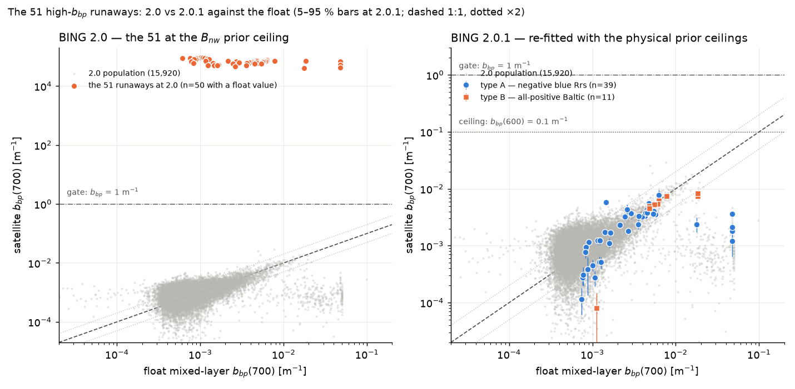

# The high-`b_bp` outliers in the BING 2.0 fits

*Investigation for `claude_prompts/v2/report_improvements.md` → Prompts/Outliers 1
(2026-10-18, run with Fable). Database: `$PAB_DATA_DIR/v2/pab.db`, opened
read-only. Spectra and chains: the 51 outlier NPZs plus a 300-fit random sample
copied from the Drive backup `AIOcean:PAB/v2/fit_chains/`. Figures in
[`high_bbp_outliers/`](high_bbp_outliers/). Nothing in `pab/` was changed; the
re-fits below are exploratory, not production results.*

## Summary

- **51 of 15,971 BING 2.0 fits have `b_bp`(700) above 1 m⁻¹, and all 51 are
  above 10⁴ m⁻¹** (5.0×10⁴–9.3×10⁴). The two thresholds select the same set:
  the 52nd-largest value is 0.03 m⁻¹, six orders of magnitude lower. There is
  no continuum of "somewhat high" values, so this report covers exactly those
  51. All 51 have `success = 1`, 47 distinct granules, 25 floats.
- **They are not clear-water retrievals.** The run report (§2.5) called them
  the "ultra-oligotrophic tail" because the *retrieved* Chl is 0.01 mg m⁻³ —
  but that Chl is part of the failed fit. The floats under them have a median
  Chl of **0.93 mg m⁻³** (population 0.15) and median `b_bp`(700) of
  **3.6×10⁻³ m⁻¹** (population 6.9×10⁻⁴). They sit in optically complex
  marginal seas: **25 in the Baltic**, 9 in the tropical Atlantic/Caribbean,
  7 in the Arabian Sea/Gulf of Oman, and singles in the Black Sea, the
  Ligurian Sea, the Barents and Labrador Seas, the Kuroshio–Oyashio region,
  the NE Pacific coast, the California Current and the Agulhas.
- **The observed spectra are pathological in the blue.** 40 of 51 (type A)
  have *negative* Rrs at 400–450 nm (down to −4.3×10⁻³ sr⁻¹; median minimum
  −1.0×10⁻³, i.e. −1.2 σ of the stored `Rrs_unc`) — the signature of a failed
  atmospheric correction, typically at a cloud edge (median granule cloud
  cover 68 %). The other 11 (type B, all Baltic) are positive everywhere but
  have Rrs(440)/Rrs(555) = 0.24–0.55 against a population median of 4.1 — a
  CDOM-rich, green-peaked spectrum that is plausibly real water.
- **What went wrong is the optimiser, not the sampler.** Every one of the 51
  chains *started* with `Bnw` (log₁₀ of `b_bp`(600)) above 4.5 — the LM
  warm-start delivered the walkers to the prior ceiling (`Bnw` ≤ 5, i.e.
  10⁵ m⁻¹) and the 1 % walker ball never left it (minimum `Bnw` seen anywhere
  in any chain: 2.9). The χ² surface has **two basins**: a physical one
  (`b_bp`(600) ≈ 5×10⁻⁴–8×10⁻³ m⁻¹) and a spurious one at the ceiling, where
  `b_b ≫ a` and the forward model's reflectance saturates at a level set by
  the backscatter ratio `B_p` rather than by `b_b`; they are separated by a
  χ² wall of 10²–10⁵ at `b_bp` ≈ 1–10 m⁻¹. In all four re-fitted cases the
  physical basin is the *better* fit (reduced χ² 1.8 vs 11.1, 0.45 vs 10.5,
  2.3 vs 7.0, 0.21 vs 1.7), and its `b_bp`(700) agrees with the float and
  with the 1.0 Gordon fit to within a factor of ~2. The production LM, run
  from the same initial guess, lands in the spurious basin for 3 of the 4;
  perturbed starts land there 0, 2, 6 and 3 times out of 12.
- **A pre-fit screen "any Rrs < 0 at 400–450 nm" catches 40/51** and flags
  about 0.7 % of the rest (2 of 300 sampled, ≈ 100 fits), and those two are
  themselves doubtful. Adding "Rrs(440)/Rrs(555) < 0.6" catches 50/51 but
  the extra flags are *good* Baltic/high-latitude fits.
- **Recommended:** (i) keep reporting the 51 as failed retrievals and drop
  them from the `b_bp` statistics behind an explicit plausibility gate; (ii)
  re-fit the 51 under a new `pab_version` with a physical ceiling on the
  `Bnw` prior (10⁻¹ m⁻¹ instead of 10⁵) and/or a multi-start LM, and verify
  that the chains start in the physical basin; (iii) record a per-fit Rrs QA
  flag (negative blue bands) rather than refusing to fit. Questions are in
  the prompt doc under Q&A/Outliers.

## 1. Identification

Quantity `BING_ExpBPow_bbp700` on the 15,971 `fits` rows with
`algorithm = 'BING'`, `pab_version = '2.0'`:

| threshold | fits |
|---|---|
| `b_bp`(700) > 0.01 m⁻¹ | 92 |
| > 0.03 | 51 |
| > 1 (`BBP_IMPLAUSIBLE`, the report's gate) | 51 |
| > 10⁴ (the prompt's number) | 51 |
| maximum | 9.32×10⁴ m⁻¹ (6903874/139) |

The 51 are the same whichever of the two thresholds is used. By region
(float position) and by observed-spectrum type:

| region | n | with negative Rrs at 400–450 nm | float Chl (median, mg m⁻³) | float `b_bp`(700) (median, m⁻¹) |
|---|---|---|---|---|
| Baltic Sea (floats 1902683, 4903784, 2903902, 4903850) | 25 | 14 | 1.25 | 5.6×10⁻³ |
| tropical Atlantic / Caribbean | 9 | 8 | 0.25 | 1.1×10⁻³ |
| Arabian Sea / Gulf of Oman | 7 | 7 | 0.60 | 1.3×10⁻³ |
| NW Pacific (Kuroshio–Oyashio) | 2 | 1 | 4.2 | 5.0×10⁻³ |
| NE Pacific coast | 2 | 2 | 1.0 | 1.5×10⁻³ |
| Agulhas, Barents, Labrador, California, Black Sea, Ligurian | 6 | 6 | 0.3–2.4 | 0.7–5.7×10⁻³ |

Three floats account for 25 of the 51 (1902683: 10, 4903784: 10, 2903902: 5),
all in the Baltic. 48 of the 51 are 1.0-era matchups and 3 are from the 2.0
backfill, in proportion to the two populations (14,605 : 1,366).

Against the full population (medians):

| | 51 outliers | all 15,971 |
|---|---|---|
| reduced χ² | 5.9 (4 below 1.5) | 0.42 (747 above 1.5) |
| retrieved Chl (from `Aph`) | 0.012 | 0.17 |
| retrieved `A_dg` (m⁻¹) | 1,975 (49 above 10; two "mirror" fits have `A_ph` 50–330 instead) | 0.018 |
| `B_p` | 0.0053 (17 at the 0.004 floor) | 0.024 |
| β | 1.57 (27 above 1.5, 11 below 0.2) | 0.40 |
| float Chl (mg m⁻³) | **0.93** (35 of 50 above 0.5; population 27 %) | 0.15 |
| float `b_bp`(700) (m⁻¹) | **3.6×10⁻³** (31 of 50 above 2×10⁻³; population 10 %) | 6.9×10⁻⁴ |
| NASA-GIOP `b_bp`(700) (m⁻¹) | 1.5×10⁻³ (GIOP/float median 0.64) | 8.2×10⁻⁴ |
| BING 1.0 `b_bp`(700), same pixel (48 found) | 3.8×10⁻³ (1.0/float median 0.95; max 8.8×10⁻³) | — |
| latitude > 40° | 33 (65 %) | 19 % |
| θ_s > 60° (the emulator's supported limit) | 3 (71°, 65°, 65°) | 8.8 % |
| granule cloud cover (%) | 68 | 64 |
| separation, Δt | 0.75 km, 10.4 h | 0.80 km, 10.2 h |

The 5–95 % band of `Bnw` reaches 9.5–9.97×10⁴ m⁻¹ on every one of the 51 —
the posterior is pressed against the prior ceiling of 10⁵ m⁻¹
(`bing.parameters.standard.expb_pow`: `Bnw` log-uniform on [10⁻⁶, 10⁵]).
The `Bnw`–`A_dg` posterior correlation is +0.9 for 49 of the 51: it is the
ratio `a/b_b`, not `b_b`, that the data constrain there.

## 2. What the observed spectra look like

*The observed Rrs of the 51 runaway fits (left: the 40 type-A spectra with
negative Rrs at 400–450 nm; right: the 11 type-B spectra, all Baltic) over
the 5–95 % envelope and median of a random 300-fit sample of the population.
Every outlier spectrum is green-peaked (Rrs maximum at 490–580 nm) and sits
below the population's 5th percentile in the blue; the population median
peaks at 400 nm.*

*BING 2.0 `b_bp`(700) against two blue-band diagnostics of the observed
spectrum. Left: Rrs(440)/Rrs(555) — the population spans 0.7–10 (1st–99th
percentile), the outliers −0.8 to 1.9 (44 of 51 below 0.6). Right: the
minimum Rrs at 400–450 nm — 40 outliers are negative; 0.7 % of the sample is.
Note the low-end pile-up of sample values at 2–4×10⁻⁶ m⁻¹ (the prior floor;
a separate issue, not treated here) sits at perfectly ordinary blue ratios.*

*Positions of the 51 (float positions) over all 15,971 fits.*

Type A is the signature of a failed atmospheric correction: the negative
values are concentrated at 400–430 nm, grow toward 400 nm, and the pixels
carry none of the `l2_flags` in `STANDARD_OCEAN_MASK` (`ATMFAIL`, `HILT`,
`STRAYLIGHT`, `CLDICE`, `LOWLW`, …) — the L2 processor did not consider them
failures. The stored `Rrs_unc` at 400 nm is 6–12×10⁻⁴ sr⁻¹ on these pixels,
so a value of −10⁻³ is only 1–2 σ from zero and the likelihood does not
object to it much (the blue bands contribute 16 % of the stored fit's χ² on
6903874/139). The quick-looks show the kind of scene: 6903874/139 is a few
clear pixels in a 96 %-cloudy swath, the float at the edge of the patch.

Type B spectra (positive everywhere, Rrs(440)/Rrs(555) ≈ 0.2–0.5, Rrs(555)
≈ 2.5–3.4×10⁻³ sr⁻¹) are what summer Baltic water looks like: strong CDOM
absorption in the blue and a green/red reflectance peak; the July 2024 scene
of 4903784/112 shows the bright green bloom around the float. Their fits
fail for the same reason as type A, without the negative values — the shape
alone is enough.

## 3. A few of the fits

The stored 2.0 fit figures (observed Rrs, BING posterior median and 5–95 %
band; `b_bp(λ)` below). In every panel the model curve *rises* toward 400 nm
while the data fall — the runaway solution has no blue absorption shape at
all.

| | |
|---|---|
|  |  |

*6903874/139, equatorial Atlantic (1.1°S, 5.0°W), 2024-08-25, θ_s = 20°,
Δt 2.1 h, 0.4 km. Type A: Rrs from −1.6×10⁻³ at 400 nm through zero at ~435 nm
to 1.9×10⁻³ at 490 nm. `b_bp`(700) = 9.3×10⁴ m⁻¹ (5–95 %: 7.8–9.9×10⁴),
`A_dg` = 633 m⁻¹, β = 0.04, `B_p` = 0.004, χ² = 11.1. Float `b_bp`(700)
1.0×10⁻³, BING 1.0 7.0×10⁻⁴, GIOP 1.2×10⁻³. Right: the scene quick-look — a
96 %-cloudy granule, the float at the edge of a small clear patch.*

*7901007/400, Barents Sea (75.9°N, 43.0°E), 2025-06-05, θ_s = 54°. The most
negative spectrum of the 51: −4.3×10⁻³ sr⁻¹ at 400 nm, 20 negative bands up
to 457 nm. `b_bp`(700) = 6.3×10⁴, `A_dg` = 661, β = 1.79, χ² = 7.0. Float
2.9×10⁻³, BING 1.0 4.6×10⁻³. The physical LM solution (§4) gives 3.6×10⁻³.*

| | |
|---|---|
|  |  |

*4903784/112, Baltic (55.4°N, 15.3°E), 2024-07-07, θ_s = 34°. Type B: no
negative band, Rrs(440)/Rrs(555) = 0.24, peak 2.7×10⁻³ at 560 nm.
`b_bp`(700) = 7.2×10⁴, `A_dg` = 2,050, β = 1.82, χ² = 10.5. Float `b_bp`(700)
1.8×10⁻², BING 1.0 8.0×10⁻³, GIOP 6.0×10⁻³; the physical LM solution gives
7.6×10⁻³. Four consecutive cycles of this float (111–114) on the same
granule are all runaways. Right: the scene — a bright green summer bloom
around the float.*

*2903902/30, Baltic (55.3°N, 15.6°E), 2024-06-21. The "mirror" mode: here
`A_ph` ran away instead of `A_dg` (`A_ph` = 330 m⁻¹, retrieved Chl 5,900
mg m⁻³, `A_dg` = 0.01), with the same `b_bp` at the ceiling (7.1×10⁴) and a
deceptively ordinary χ² of 1.7 — the lowest-χ² runaway is 0.60, so χ² alone
cannot isolate them. The physical LM solution gives χ² = 0.21 and
`b_bp`(700) = 6.5×10⁻³ against the float's 6.2×10⁻³.*

*1902660/51, Gulf of Oman (24.6°N, 62.6°E), 2026-01-02, Δt 18 h. Type A with
a mild negative blue (−5×10⁻⁴ at 400 nm) — the Arabian Sea group (7 fits,
floats 1902660, 1902751, 2902272, 6990700) is the dust-aerosol regime where
the standard atmospheric correction is known to over-correct the blue.*

*4902683/264, NE Pacific coast (51.8°N, 131.2°W), 2026-01-23, **θ_s = 71°** —
outside the emulator's supported solar-zenith range (0–60°; 3 of the 51 and
8.8 % of all fits are). A winter high-latitude scene with Rrs negative to
460 nm and a second dip at 660 nm. `b_bp`(700) = 8.3×10⁴, χ² = 1.6.*

## 4. Why BING answers a depressed blue with `b_bp` = 10⁵ m⁻¹

**The saturation limit.** In any reflectance model Rrs is driven by
`u = b_b/(a + b_b)`. Once `b_b ≫ a`, `u → 1` and Rrs stops depending on the
*magnitude* of `b_b`; only the ratio `a/b_b` matters (which is why `Bnw` and
`A_dg` are +0.9-correlated in the outlier posteriors, with `A_dg` at
10²–10⁴ m⁻¹). In the ZTT backbone that 2.0 uses
(`robust.rt.ztt.rrs_ZTT`),

    rrs = (1/µ_d)(β(ψ)/b_b) / [ (a/b_b)(1 − cosθ_v Ψ/µ_∞) + f_L(1 − 1/b̃_b) + 1/b̃_b ],

and in the `a/b_b → 0` limit the denominator is set by `1/b̃_b`, where
`b̃_b = b_b/b ≈ B_p` once particles dominate. With `B_p` at its 0.004 floor
(17 of the 51 are there) the saturated reflectance is a few ×10⁻⁴ sr⁻¹ —
the same order as these dim spectra — and nearly flat in wavelength, with
what spectral shape remains coming from `f_L(ψ, λ)`, the residual `a/b_b`
term, and the hybrid emulator's correction. That correction is evaluated far
outside its training domain here (features `log₁₀ u ≈ 0` and
`b_bw/b_b ≈ 10⁻⁸`); BING calls `robust.rt.forward` with the default
`on_out_of_domain = "warn"` policy, and under `jit` the warning is silent, so
the emulator extrapolates freely. The result is the blue-rising model curve
in every figure above. (`µ_∞` from TT2017 is likewise fitted only over
`b_b/a` = 10⁻⁴–10⁻¹.)

**Two basins, and the chains began in the wrong one.** The χ² profile below
fixes `Bnw` and re-optimises the other five parameters. For all four cases
there is a physical minimum at `b_bp`(600) ≈ 5×10⁻⁴–8×10⁻³ m⁻¹, a wall at
1–10 m⁻¹ (reduced χ² 10²–10⁵, where `u` passes through the emulator's edge),
and a second, shallower basin that descends monotonically to the prior
ceiling at 10⁵ m⁻¹. The stored posteriors (triangles) are in that second
basin, 1.5–23× worse in χ² than the physical one.

*(a) Reduced-χ² profile versus fixed log₁₀ `Bnw` (`b_bp` at 600 nm) for four
outliers, other parameters re-optimised by LM at each point; triangles mark
the stored posterior-median χ² at the ceiling. (b, c) Observed Rrs with the
stored runaway model and the physical-basin LM solution for 6903874/139 and
4903784/112.*

The chains confirm which basin the sampler was *given*: at step 0 of every
one of the 51 chains the median walker `Bnw` is 4.7–4.99, and no walker in any
chain ever went below 2.9. PAB's `fit_spectrum` seeds the 16 walkers in a 1 %
ball around the LM warm-start (`bing.fitting.inference.init_walkers`,
`frac = 0.01`), and emcee's stretch move cannot carry such a ball across a
χ² wall of 10⁵; so the LM warm-start (`bing.fitting.chisq_fit.fit`, i.e.
`scipy.optimize.curve_fit` with the prior bounds) must have ended at the
ceiling. The `success` flag only records that `curve_fit` returned, which it
did.

**Exploratory re-fits** (LM only, no MCMC; same `Rrs`/`Rrs_unc`, geometry and
Chl seed as the stored fit; forward model `robust_hybrid` with Raman and
Chl fluorescence; run on the workstation CPU in float32 — *not* production
results):

| fit | stored χ² (ceiling) | LM from the production initial guess | LM with physical ceilings (`b_bp`(600) ≤ 0.1, `A_dg`, `A_ph` ≤ 10 m⁻¹) | physical `b_bp`(700) | float / BING 1.0 / GIOP | 12 perturbed starts ending at the ceiling |
|---|---|---|---|---|---|---|
| 6903874/139 (type A) | 11.1 | **1.81**, physical basin | 1.81 | 4.3×10⁻⁴ | 1.0×10⁻³ / 7.0×10⁻⁴ / 1.2×10⁻³ | 0 |
| 4903784/112 (type B) | 10.5 | 10.5, ceiling | **0.45** | 7.6×10⁻³ | 1.8×10⁻² / 8.0×10⁻³ / 6.0×10⁻³ | 2 |
| 7901007/400 (type A) | 7.0 | 7.0, ceiling | **2.35** | 3.6×10⁻³ | 2.9×10⁻³ / 4.6×10⁻³ / 1.4×10⁻³ | 6 |
| 2903902/30 (type A, `A_ph` mirror) | 1.7 | 1.7, ceiling | **0.21** | 6.5×10⁻³ | 6.2×10⁻³ / 7.9×10⁻³ / 5.0×10⁻³ | 3 |

Three findings from this:

1. The physical basin exists and wins on χ² in every case; its `b_bp`(700)
   is within a factor of ~2 of the float and of the 1.0 Gordon fit. The data
   are usable — the optimiser just did not find the right minimum.
2. The LM is start-sensitive on these spectra: from the production initial
   guess it reproduces the ceiling for three of four, and perturbing the
   start by ±0.3 dex sends 0–50 % of runs to the ceiling. (For 6903874/139
   the workstation LM found the physical basin where the pod's did not; the
   JAX forward model ran on a GPU there and on the CPU here, and a
   path-dependent optimiser next to a wall can diverge on such differences.
   The chains leave no doubt about where the production LM ended.)
3. **Removing the negative bands does not fix it.** With the negative bands
   masked and the full prior bounds, 6903874/139 and 7901007/400 still go to
   the ceiling (χ² 10.2 and 2.5); 2903902/30 goes physical (χ² 0.04). The
   negative values mark the bad pixels but are not what the runaway fits —
   the depressed-blue *shape* is, which is why the all-positive Baltic
   spectra fail identically. A physical ceiling on the prior removes the
   spurious basin outright; a screen merely avoids some of the spectra that
   have it.

## 5. Would a pre-fit screen catch them?

Catch rate on the 51, false-positive rate on the 300-fit random sample
(scaled to the 15,920 non-outliers):

| screen | catches (of 51) | flags in the sample | ≈ non-outlier fits flagged |
|---|---|---|---|
| any Rrs < 0 at 400–450 nm | **40** | 2 (0.7 %) | ~100 |
| any Rrs < 0 anywhere in 400–700 nm | 40 | 21 (7.0 %) | ~1,100 |
| any Rrs < −1 σ (stored `Rrs_unc`) | 40 (by construction of the 51) | 6 (2.0 %) | ~300 |
| Rrs(440)/Rrs(555) < 0.6 | 44 | 3 (1.0 %) | ~160 |
| Rrs(440)/Rrs(555) < 1.0 | 46 | 11 (3.7 %) | ~580 |
| negative blue **or** ratio < 0.6 | **50** | 3 (1.0 %) | ~160 |

The two sample fits the negative-blue screen flags are 4903784/178 (Baltic;
19 negative bands; BING 1.2×10⁻³ against a float value of 4.8×10⁻² — a
40-fold underestimate, so a failed fit of a different kind) and 3902472/64
(Agulhas; minimum −1.3×10⁻³; BING 6.5×10⁻⁴ vs float 1.0×10⁻³, χ² 1.0 — a
plausible fit on a doubtful pixel). The negative-blue screen therefore costs
essentially no *good* fits. The ratio screen does: the 11 sample fits with
Rrs(440)/Rrs(555) < 1 are Baltic and subpolar fits with χ² 0.1–1.1 and
sat/float ratios 0.6–1.4 — exactly the productive-water matchups the report
wants to keep. "Any negative anywhere" is useless (the 600–700 nm bands dip
below zero on 7 % of ordinary clear-water spectra).

Note the 11 type-B outliers are indistinguishable *by their spectra* from
good Baltic fits (the sample's 2903902/39, on the same float series, has
ratio 0.73 and a sat/float `b_bp` ratio of 1.3). No Rrs screen separates
them; only the fit set-up can.

Context, not treated here: the low-end pile-up of 2.0 `b_bp` at 2–4×10⁻⁶ m⁻¹
(the prior floor; 9 of the 300 sampled fits, none with a negative blue band,
blue ratio 4.7 — clear water) and the GIOP floor band at 2–4×10⁻⁴ m⁻¹ are
separate problems with ordinary spectra.

## 6. Recommended next steps

1. **Report now.** Keep the 51 out of the `b_bp` statistics behind the
   existing `BBP_IMPLAUSIBLE = 1 m⁻¹` gate and say so in the caption (51
   failed retrievals, 0.32 %), rather than leaving them in the medians; and
   amend the run report's §2.5 — the regime is marginal seas with a depressed
   or negative blue Rrs, not oligotrophic water.
2. **Re-fit the 51** under a new `pab_version` (the design's rule: a new
   record, never an overwrite), with the spurious basin removed: a physical
   ceiling on `Bnw` (10⁻¹ m⁻¹ at 600 nm; the open ocean spans 10⁻⁴–10⁻¹) and
   on `A_dg`/`A_ph` (≈10 m⁻¹), applied as a PAB-side override of
   `expb_pow`'s priors so BING's own defaults are untouched; and/or a
   multi-start LM (best of N perturbed starts, or seeded from the 1.0 Gordon
   solution, which exists for 48 of the 51). Then check that step 0 of every
   chain is in the physical basin. Expected cost: 51 × ~3 min.
3. **Store an Rrs QA flag** per fit — "n bands with Rrs < 0 at 400–450 nm"
   as a `fit_results` quantity or a `matchup_pixels` column — so the report
   can show it and a reader can filter on it. Refusing to fit such pixels is
   not recommended: 2903902/30 fits well once the right basin is found, and
   the Baltic type-B spectra are not screenable anyway.
4. **Ask the emulator to stay in domain.** `robust.rt.forward` has an
   `on_out_of_domain = "ztt"` policy (fall back to the analytic backbone
   outside the training range); BING uses the default `"warn"`, which is
   silent under `jit`. Running with `"ztt"` would at least make the
   out-of-domain Rrs the analytic one. Worth a slice test; it may change
   the wall, not the basin.
5. **Look at the 1.0-vs-2.0 comparison for the Baltic.** 10 of the 51 are
   one float (4903784) and four of them are consecutive cycles on one
   granule; the same float and granule produce good fits in the sample. A
   per-float view of the 2.0/1.0 ratio for the three Baltic floats would show
   how far the ceiling basin reaches below the 1 m⁻¹ gate (nothing between
   0.03 and 10⁴ m⁻¹ suggests it is all-or-nothing, but the `A_dg`-mirror case
   with χ² = 1.7 says the basin is not always detectable).

## Appendix A — the 51 fits

Sorted by `b_bp`(700). `A_dg` and Chl are the 2.0 posterior medians; "n(Rrs<0)"
counts negative observed bands at 400–450 nm; the float value is the mixed-layer
`bbp700`; BING 1.0 is the Gordon fit of the same pixel (blank where none);
GIOP is NASA's `bbp_442` shifted to 700 nm with its per-pixel slope.

| WMO/cycle | date | lat | lon | region | b_bp(700) BING 2.0 [m⁻¹] | 5–95 % | A_dg [m⁻¹] | Chl_BING | β | B_p | χ²_red | n(Rrs<0, 400–450) | Rrs(440)/Rrs(555) | float b_bp(700) | BING 1.0 b_bp(700) | GIOP b_bp(700) | dist [km] | Δt [h] | θ_s |
|---|---|---|---|---|---|---|---|---|---|---|---|---|---|---|---|---|---|---|---|
| 6903874/139 | 2024-08-25 | -1.1 | -5.0 | tropical Atlantic / Caribbean | 9.32e+04 | 7.8e+04–9.9e+04 | 633 | 0.00673 | 0.04 | 0.0040 | 11.11 | 12 | 0.40 | 1.01e-03 | 7.04e-04 | 1.19e-03 | 0.4 | 2.1 | 20 |
| 6990528/121 | 2024-09-16 | 42.7 | 8.3 | Mediterranean | 9.29e+04 | 7.4e+04–9.9e+04 | 8.31e+03 | 0.0102 | 0.01 | 0.0040 | 15.34 | 4 | 1.88 | 7.44e-04 | 4.84e-04 | 4.71e-04 | 0.3 | 22.1 | 43 |
| 1902601/95 | 2025-01-29 | 11.9 | -25.8 | tropical Atlantic / Caribbean | 9.29e+04 | 7.4e+04–9.9e+04 | 2.21e+03 | 0.003 | 0.02 | 0.0040 | 12.94 | 3 | 1.44 | 1.07e-03 | 6.07e-04 | 3.77e-04 | 2.8 | 22.6 | 31 |
| 4903904/6 | 2025-08-14 | 17.8 | -67.9 | tropical Atlantic / Caribbean | 9.05e+04 | 6.9e+04–9.9e+04 | 4.46e+03 | 0.0175 | 0.02 | 0.0040 | 11.12 | 1 | 1.53 | 6.07e-04 | 1.20e-04 | 1.31e-04 | 3.4 | 10.4 | 18 |
| 4903489/51 | 2024-07-22 | -2.9 | -16.5 | tropical Atlantic / Caribbean | 9.01e+04 | 6.7e+04–9.9e+04 | 5.92e+03 | 0.00666 | 0.02 | 0.0040 | 11.20 | 0 | 1.44 | 1.13e-03 | 3.45e-04 | 3.38e-04 | 0.6 | 11.7 | 30 |
| 1902498/12 | 2024-06-06 | -5.3 | -3.1 | tropical Atlantic / Caribbean | 9.01e+04 | 6.8e+04–9.9e+04 | 6.31e+03 | 0.00726 | 0.03 | 0.0040 | 11.38 | 6 | 1.12 | 7.58e-04 | 5.93e-04 | 1.01e-03 | 0.8 | 15.8 | 35 |
| 4903462/128 | 2026-05-05 | 10.0 | -53.7 | tropical Atlantic / Caribbean | 8.69e+04 | 6.3e+04–9.7e+04 | 1.92e+03 | 0.00637 | 0.09 | 0.0041 | 9.41 | 10 | 0.50 | 8.98e-04 | 1.24e-03 | 1.30e-03 | 0.7 | 20.6 | 15 |
| 6903877/215 | 2026-07-09 | -0.1 | -23.7 | tropical Atlantic / Caribbean | 8.35e+04 | 5.5e+04–9.7e+04 | 8.05e+03 | 0.0225 | 0.07 | 0.0041 | 12.12 | 2 | 0.56 | 1.21e-03 | — | 7.94e-04 | 0.8 | 4.2 | 24 |
| 4902683/264 | 2026-01-23 | 51.8 | -131.2 | NE Pacific coast | 8.30e+04 | 5.9e+04–9.6e+04 | 184 | 0.0091 | 0.30 | 0.0041 | 1.61 | 18 | -0.29 | 8.79e-04 | 5.81e-04 | 8.70e-04 | 0.3 | 9.0 | 71 |
| 2903886/75 | 2025-01-08 | 32.2 | -122.9 | California Current | 8.23e+04 | 5.4e+04–9.8e+04 | 1.97e+03 | 0.00947 | 0.05 | 0.0040 | 5.94 | 10 | 0.58 | 1.27e-03 | 1.08e-03 | 1.16e-03 | 0.7 | 18.7 | 56 |
| 1902660/51 | 2026-01-01 | 24.6 | 62.6 | Arabian Sea / Gulf of Oman | 8.11e+04 | 5.1e+04–9.7e+04 | 2.01e+03 | 0.00809 | 0.11 | 0.0041 | 5.06 | 9 | 0.48 | 8.39e-04 | 2.02e-03 | 1.48e-03 | 0.1 | 18.3 | 48 |
| 1902683/192 | 2024-07-22 | 55.3 | 19.3 | Baltic Sea | 7.95e+04 | 6.4e+04–9.2e+04 | 3.33e+03 | 0.00411 | 1.07 | 0.0092 | 14.45 | 0 | 0.33 | 6.27e-03 | 6.42e-03 | 5.91e-03 | 1.0 | 22.1 | 36 |
| 2903902/49 | 2024-08-17 | 55.4 | 15.7 | Baltic Sea | 7.41e+04 | 5.7e+04–9.0e+04 | 6.24e+03 | 0.00756 | 1.38 | 0.0077 | 12.56 | 0 | 0.49 | 4.80e-03 | 5.09e-03 | 4.16e-03 | 0.8 | 0.1 | 42 |
| 1902683/158 | 2024-05-21 | 55.3 | 19.3 | Baltic Sea | 7.30e+04 | 6.2e+04–8.1e+04 | 3.15e+03 | 0.00498 | 1.73 | 0.0102 | 15.13 | 0 | 0.38 | 7.75e-03 | 7.50e-03 | 7.83e-03 | 0.6 | 8.4 | 35 |
| 4902679/162 | 2025-04-02 | 50.6 | -132.0 | NE Pacific coast | 7.26e+04 | 5.5e+04–8.5e+04 | 622 | 0.00761 | 1.45 | 0.0041 | 7.99 | 20 | -0.37 | 2.15e-03 | 2.86e-03 | 9.65e-04 | 4.5 | 12.7 | 46 |
| 6903874/140 | 2024-09-04 | -1.1 | -5.2 | tropical Atlantic / Caribbean | 7.23e+04 | 4.3e+04–9.0e+04 | 1.15e+04 | 0.0148 | 0.78 | 0.0043 | 12.92 | 2 | 0.65 | 1.15e-03 | 1.60e-03 | 1.49e-03 | 4.5 | 17.6 | 22 |
| 4903784/112 | 2024-07-08 | 55.4 | 15.3 | Baltic Sea | 7.22e+04 | 6.2e+04–7.8e+04 | 2.05e+03 | 0.00892 | 1.82 | 0.0090 | 10.50 | 0 | 0.24 | 1.83e-02 | 7.97e-03 | 5.97e-03 | 0.9 | 19.7 | 34 |
| 4903784/113 | 2024-07-08 | 55.4 | 15.3 | Baltic Sea | 7.22e+04 | 6.0e+04–7.9e+04 | 2.45e+03 | 0.00483 | 1.83 | 0.0092 | 11.12 | 0 | 0.28 | 1.84e-02 | 8.78e-03 | 7.06e-03 | 0.8 | 21.8 | 34 |
| 4903784/111 | 2024-07-08 | 55.4 | 15.3 | Baltic Sea | 7.21e+04 | 6.0e+04–7.8e+04 | 2.07e+03 | 0.00979 | 1.83 | 0.0089 | 10.50 | 0 | 0.24 | 1.83e-02 | 7.97e-03 | 5.97e-03 | 0.8 | 17.8 | 34 |
| 4903784/114 | 2024-07-08 | 55.4 | 15.3 | Baltic Sea | 7.19e+04 | 5.9e+04–7.9e+04 | 2.35e+03 | 0.00448 | 1.82 | 0.0093 | 11.12 | 0 | 0.28 | 1.84e-02 | 8.80e-03 | 7.06e-03 | 0.5 | 23.8 | 34 |
| 2902272/215 | 2025-03-13 | 18.4 | 59.8 | Arabian Sea / Gulf of Oman | 7.15e+04 | 4.1e+04–9.2e+04 | 480 | 0.00894 | 0.61 | 0.0042 | 4.31 | 20 | -0.76 | — | 4.03e-04 | 8.95e-04 | 1.6 | 3.4 | 27 |
| 2903902/30 | 2024-06-20 | 55.3 | 15.6 | Baltic Sea | 7.11e+04 | 3.1e+04–9.3e+04 | 0.0104 | 5.92e+03 | 0.49 | 0.0056 | 1.71 | 16 | 0.01 | 6.23e-03 | 7.85e-03 | 5.03e-03 | 0.9 | 21.5 | 32 |
| 2903902/50 | 2024-08-20 | 55.3 | 15.6 | Baltic Sea | 6.99e+04 | 5.3e+04–7.6e+04 | 820 | 0.00637 | 1.87 | 0.0100 | 9.64 | 17 | -0.01 | 4.76e-03 | 5.48e-03 | 3.04e-03 | 1.1 | 0.2 | 43 |
| 6990668/89 | 2025-06-16 | 59.4 | -50.7 | Labrador Sea | 6.99e+04 | 4.6e+04–9.1e+04 | 2.16e+04 | 0.00932 | 1.60 | 0.0052 | 17.42 | 3 | 0.66 | 2.69e-03 | 2.20e-03 | 1.01e-03 | 1.0 | 0.2 | 37 |
| 4903850/28 | 2026-04-22 | 42.3 | 152.1 | NW Pacific (Kuroshio-Oyashio) | 6.91e+04 | 5.1e+04–7.6e+04 | 1.51e+03 | 0.00299 | 1.88 | 0.0116 | 9.79 | 0 | 0.26 | 6.03e-03 | 5.41e-03 | 4.03e-03 | 0.3 | 2.5 | 30 |
| 7901065/58 | 2024-11-30 | 42.7 | 34.8 | Black Sea | 6.90e+04 | 4.3e+04–8.7e+04 | 8.59e+03 | 0.0156 | 1.62 | 0.0050 | 15.38 | 13 | 0.09 | 5.73e-03 | 4.13e-03 | 3.51e-03 | 0.5 | 1.6 | 65 |
| 4903784/185 | 2025-06-11 | 55.1 | 14.5 | Baltic Sea | 6.86e+04 | 4.8e+04–8.0e+04 | 2.16e+03 | 0.00724 | 1.74 | 0.0055 | 8.45 | 18 | -0.08 | 4.78e-02 | 4.04e-03 | 2.04e-03 | 0.4 | 0.9 | 33 |
| 4902620/139 | 2026-07-23 | -27.2 | 33.2 | Agulhas / Mozambique Ch. | 6.79e+04 | 3.4e+04–9.4e+04 | 2.66e+03 | 0.0321 | 0.18 | 0.0041 | 4.21 | 11 | 0.50 | 7.74e-04 | — | 8.62e-04 | 1.0 | 5.1 | 49 |
| 4903784/173 | 2025-04-12 | 55.1 | 14.4 | Baltic Sea | 6.71e+04 | 3.8e+04–8.7e+04 | 2.28e+03 | 0.0129 | 1.26 | 0.0045 | 3.48 | 12 | 0.06 | 4.78e-02 | 2.59e-03 | 1.56e-03 | 0.7 | 23.5 | 47 |
| 1902683/208 | 2024-08-20 | 55.2 | 19.2 | Baltic Sea | 6.68e+04 | 4.3e+04–8.0e+04 | 1.14e+04 | 0.0193 | 1.78 | 0.0047 | 9.67 | 0 | 0.55 | 5.58e-03 | 5.93e-03 | 3.80e-03 | 0.7 | 7.4 | 43 |
| 4903784/129 | 2024-09-08 | 55.0 | 14.3 | Baltic Sea | 6.42e+04 | 3.7e+04–7.8e+04 | 1.14e+03 | 0.0104 | 1.75 | 0.0045 | 4.74 | 15 | 0.05 | 4.27e-03 | 4.06e-03 | 2.20e-03 | 0.6 | 23.7 | 49 |
| 2902878/195 | 2025-04-20 | 42.0 | 146.0 | NW Pacific (Kuroshio-Oyashio) | 6.28e+04 | 2.9e+04–8.1e+04 | 1.25e+03 | 0.0164 | 1.64 | 0.0079 | 3.56 | 3 | 0.20 | 3.92e-03 | 4.55e-03 | 2.84e-03 | 0.7 | 20.8 | 34 |
| 7901007/400 | 2025-06-05 | 75.9 | 43.0 | Barents Sea | 6.26e+04 | 3.1e+04–7.8e+04 | 661 | 0.012 | 1.79 | 0.0084 | 7.04 | 20 | -0.34 | 2.92e-03 | 4.63e-03 | 1.39e-03 | 0.2 | 1.3 | 54 |
| 1902683/217 | 2024-09-06 | 55.2 | 19.3 | Baltic Sea | 6.12e+04 | 3.1e+04–7.9e+04 | 2.46e+03 | 0.0182 | 1.73 | 0.0061 | 4.54 | 0 | 0.34 | 4.81e-03 | 5.68e-03 | 3.17e-03 | 0.7 | 4.0 | 49 |
| 1902751/19 | 2025-05-17 | 20.3 | 59.6 | Arabian Sea / Gulf of Oman | 5.99e+04 | 2.5e+04–8.4e+04 | 3.47e+03 | 0.0145 | 1.31 | 0.0044 | 5.76 | 13 | 0.21 | 8.30e-04 | 9.76e-04 | 1.35e-03 | 0.5 | 16.2 | 19 |
| 1902683/223 | 2024-09-17 | 55.2 | 19.3 | Baltic Sea | 5.99e+04 | 2.0e+04–8.6e+04 | 0.00203 | 903 | 1.11 | 0.0047 | 1.50 | 20 | -0.33 | 4.33e-03 | 3.81e-03 | 1.20e-03 | 0.5 | 3.9 | 53 |
| 1902660/21 | 2025-05-12 | 21.6 | 59.8 | Arabian Sea / Gulf of Oman | 5.94e+04 | 3.0e+04–7.7e+04 | 3.24e+03 | 0.00979 | 1.79 | 0.0053 | 7.83 | 16 | 0.07 | 1.42e-03 | 1.87e-03 | 1.67e-03 | 0.6 | 10.8 | 17 |
| 1902683/216 | 2024-09-04 | 55.2 | 19.3 | Baltic Sea | 5.90e+04 | 2.8e+04–7.7e+04 | 1.55e+03 | 0.0202 | 1.77 | 0.0051 | 4.71 | 8 | 0.19 | 5.42e-03 | 6.08e-03 | 2.63e-03 | 2.1 | 0.5 | 49 |
| 1902660/56 | 2026-02-18 | 24.9 | 63.4 | Arabian Sea / Gulf of Oman | 5.89e+04 | 2.3e+04–7.7e+04 | 119 | 0.0348 | 1.78 | 0.0115 | 4.02 | 17 | -0.05 | 3.61e-03 | 4.75e-03 | 1.82e-03 | 2.5 | 0.8 | 36 |
| 1902683/218 | 2024-09-08 | 55.2 | 19.3 | Baltic Sea | 5.84e+04 | 1.8e+04–8.1e+04 | 584 | 0.0166 | 1.65 | 0.0086 | 2.54 | 11 | 0.15 | 4.51e-03 | 4.62e-03 | 2.54e-03 | 0.7 | 7.5 | 50 |
| 2903902/58 | 2024-09-15 | 55.3 | 15.1 | Baltic Sea | 5.77e+04 | 2.3e+04–7.6e+04 | 443 | 0.015 | 1.73 | 0.0060 | 4.51 | 18 | -0.03 | 5.35e-03 | 3.84e-03 | 2.24e-03 | 0.6 | 1.9 | 53 |
| 1902683/330 | 2025-04-01 | 55.3 | 19.6 | Baltic Sea | 5.65e+04 | 2.3e+04–8.1e+04 | 595 | 0.0197 | 1.54 | 0.0054 | 2.43 | 18 | -0.13 | 2.46e-03 | 3.95e-03 | 1.73e-03 | 4.8 | 16.4 | 51 |
| 6990700/56 | 2026-04-19 | 24.8 | 59.4 | Arabian Sea / Gulf of Oman | 5.27e+04 | 1.9e+04–7.6e+04 | 1.36e+03 | 0.0121 | 1.71 | 0.0063 | 4.63 | 13 | 0.10 | 1.66e-03 | 1.77e-03 | 1.44e-03 | 3.8 | 3.4 | 14 |
| 4903784/170 | 2025-03-28 | 55.1 | 14.4 | Baltic Sea | 5.23e+04 | 1.6e+04–8.0e+04 | 296 | 0.0129 | 1.50 | 0.0053 | 2.31 | 20 | -0.23 | 4.78e-02 | 2.31e-03 | 8.55e-04 | 0.7 | 22.9 | 52 |
| 6990700/59 | 2026-05-18 | 23.7 | 59.7 | Arabian Sea / Gulf of Oman | 5.06e+04 | 1.8e+04–8.0e+04 | 2.38e+03 | 0.0133 | 1.61 | 0.0054 | 4.51 | 16 | 0.10 | 1.23e-03 | 1.52e-03 | 1.54e-03 | 0.9 | 16.5 | 19 |
| 2903902/19 | 2024-05-18 | 55.3 | 15.7 | Baltic Sea | 5.01e+04 | 1.4e+04–7.8e+04 | 120 | 0.0196 | 1.62 | 0.0066 | 1.50 | 13 | 0.04 | 3.54e-03 | 2.46e-03 | 1.45e-03 | 0.6 | 1.1 | 36 |
| 1902683/318 | 2025-03-10 | 55.3 | 19.7 | Baltic Sea | 5.01e+04 | 1.9e+04–7.6e+04 | 251 | 0.0235 | 1.67 | 0.0050 | 2.58 | 20 | -0.33 | 1.46e-03 | 6.46e-03 | 1.44e-03 | 3.1 | 8.9 | 59 |
| 1902499/86 | 2026-06-19 | -4.3 | 2.2 | tropical Atlantic / Caribbean | 5.01e+04 | 1.8e+04–7.8e+04 | 763 | 0.0186 | 1.59 | 0.0054 | 5.04 | 20 | -0.32 | 1.60e-03 | — | 1.25e-03 | 0.8 | 11.0 | 29 |
| 1902683/310 | 2025-02-24 | 55.3 | 19.7 | Baltic Sea | 4.59e+04 | 9.4e+03–7.8e+04 | 242 | 0.0178 | 1.57 | 0.0073 | 1.44 | 15 | 0.01 | 2.61e-03 | 4.69e-03 | 1.52e-03 | 4.1 | 15.2 | 65 |
| 4903784/179 | 2025-05-12 | 55.1 | 14.4 | Baltic Sea | 4.26e+04 | 8.8e+03–8.4e+04 | 11.8 | 0.357 | 0.99 | 0.0054 | 0.60 | 17 | -0.03 | 4.78e-02 | 1.58e-03 | 7.80e-04 | 0.1 | 0.0 | 38 |
| 4903784/86 | 2024-03-17 | 55.2 | 14.5 | Baltic Sea | 4.11e+04 | 9.3e+03–7.7e+04 | 66.7 | 0.0192 | 1.47 | 0.0061 | 0.71 | 19 | -0.16 | 1.77e-02 | 3.16e-03 | 1.34e-03 | 1.6 | 0.5 | 58 |

## Appendix B — how this was done

- Outlier table and population statistics: SQL on `fits`/`fit_results`/
  `matchups`/`profiles`/`mld_summary`/`matchup_pixels`/`granules` (read-only).
- Spectra: `wave`, `Rrs`, `varRrs` from the chain NPZs (`fits.chains_path`
  basenames fetched with `rclone copy AIOcean:PAB/v2/fit_chains/ …
  --files-from … --no-traverse`), 51 outliers + 300 random non-outliers
  (seed 42); fit figures from `AIOcean:PAB/v2/figures/`, scene quick-looks
  from `AIOcean:PAB/site/_static/scenes/`.
- Re-fits: `pab.fit.models.build_models` + `pab.fit.run` helpers
  (`_initial_guess`, `_prior_bounds`, `set_inelastic_Ed`, `reconstruct_rrs`)
  with `bing.fitting.chisq_fit.fit`; masked bands were given a variance of
  10⁶ sr⁻²; the profile re-optimises from three starts per point. Scratch
  scripts: `/tmp/claude-1000/pab-outliers/{outliers_query,spectra_out,
  spectra_sample,chain_start,refit2,tables,figs}.py`.
- Nothing was written to any database, nothing under `$PAB_DATA_DIR/v1/`, no
  code under `pab/` changed.

## Appendix C — the 2.0.1 re-fit

*Added 2026-10-18 (Prompts/Outliers O6, run with Fable). The 51 fits of
Appendix A were re-fitted under `pab_version` **2.0.1** — the same data,
physics and matchups as 2.0, with the priors capped at physical ceilings
(`prior_set = "bing_standard+ceiling:bbp600<=0.1,adg<=10,aph<=10"`, i.e.
`b_bp`(600) ≤ 0.1 m⁻¹, `A_dg` ≤ 10 m⁻¹, `A_ph` ≤ 10 m⁻¹; BING's own
log-uniform floors of 10⁻⁶ unchanged) and the input spectrum **replayed from
the 2.0 chain NPZ** (`rrs_source = "L2_AOP:replay:<2.0 fit_id>"`,
Q&A/Outliers 8 = C), so 2.0 → 2.0.1 differs by the prior and nothing else.
The 2.0 rows stay in the database untouched; the 2.0.1 rows are new records
(`fit_id` … `_v2.0.1`) and the report overlays them per matchup and pixel
(O7). Selection by SQL: [`high_bbp_outliers/refit_51.csv`](high_bbp_outliers/refit_51.csv).
Run: `pab --stage fit --jobs 8 --matchups-csv … --replay-chains …` on the
workstation (`ocean14`, CPU), 11 min 13 s for the 51 (median 198 s of CPU per
fit), 51 written / 0 failed; log `$PAB_DATA_DIR/v2/logs/refit_51_20261018.log`.*

**What the re-fit shows.**

- **All 51 are below the gate.** `b_bp`(700) at 2.0.1 spans 2.9×10⁻⁶–
  8.2×10⁻³ m⁻¹ (2.0: 4.1×10⁴–9.3×10⁴); none is above 1 m⁻¹, so O3's gate
  excludes nothing once the overlay is in place.
- **Every chain started below the wall.** `chain_start_report` over the 51
  new NPZs: `started_below_wall = True` for 51/51. Step-0 walker medians sit
  1.07–4.47 dex (median 1.57) under the `B_nw` ceiling, 0.56–1.84 dex
  (median 1.12) under the `A_dg` ceiling and 1.91–5.70 dex (median 2.49)
  under the `A_ph` ceiling. The smallest margin is `A_dg` for 1902683/223
  (0.56 dex, just over the 0.5 dex margin the check uses).
- **No posterior presses on a ceiling.** The 95 % upper bound of `b_bp`(600)
  reaches at most 0.0102 m⁻¹ (10 % of the ceiling; 2903902/30), of `A_dg` at
  most 3.7 m⁻¹ (37 %; 1902683/223, with 4903784/86 at 3.2 and 2903902/30 at
  2.9) and of `A_ph` at most 0.14 m⁻¹ (1.4 %). Nothing is within 5 % of a
  ceiling — the ceilings removed the spurious basin from the LM's reach but
  never bound the posterior.
- **χ² is lower for 51 of 51.** χ²_red(2.0)/χ²_red(2.0.1) ranges 2.3–108×
  (median 8.2×; 1902683/192: 14.4 → 0.15). At 2.0.1 the median χ²_red is
  0.61 and the maximum 2.38 (7901007/400); none is above 3. The physical
  basin is the better fit in every case, as §4 found for four of them.
- **Against the float** (50 of the 51 have a mixed-layer `bbp700`;
  2902272/215 does not): median 2.0.1/float = 0.76; **30/50 within 2×,
  40/50 within 3×**; log-RMS 0.60 dex and ρ(log) 0.60, against 0.49 dex and
  68 % within 2× for the gated 2.0 population — the re-fitted 51 are a
  noisier-than-average but ordinary part of the scatter, not a separate
  cloud. Against BING 1.0 (48 have a Gordon fit of the same pixel): median
  0.82, 40/48 within 2×. Against NASA GIOP at 700 nm: median 1.18, 36/51
  within 2×.
- **Type A (40 fits, negative blue bands; 39 with a float value):** median
  ratio 0.76, 24/39 within 2×, 30/39 within 3×; 8 below ⅓, 1 above 3×
  (1902683/318, where BING 1.0 agrees with 2.0.1 and not the float).
- **Type B (11 fits, no negative band at 400–450 nm):** 9 Baltic plus
  4903489/51 (tropical Atlantic) and 4903850/28 (Kuroshio) — Outliers 1's
  "all Baltic" was two short, the type being defined here by the stored
  `n_neg_blue = 0`. Median ratio 0.89, 6/11 within 2×, 10/11 within 3×, and
  the tightest agreement of all: |log₁₀ ratio| median 0.05 dex, 5–95 %
  bands of ±6 %. The four consecutive cycles of 4903784 (111–114) sit at
  0.40–0.45× the float, with BING 1.0 and GIOP both agreeing with 2.0.1
  rather than with the float. **O5's expectation that the type-B spectra
  would land "physical but far below the float with `A_ph` at the floor" did
  not carry over**: the one case O5 looked at, 4903489/51, is the single
  non-Baltic, non-green-peaked type-B spectrum and is the exception (below),
  while the green-peaked Baltic spectra constrain `b_bp` well.
- **Nine fits sit more than 3× below the float, in two groups.** (i) Four
  low-signal tropical/Mediterranean spectra with a sharp blue depression the
  model cannot reproduce — 6990528/121, 1902601/95, 4903904/6, 4903489/51 —
  land at 3×10⁻⁶–3×10⁻⁴ m⁻¹ (4–200× below the float) with `A_ph` at the
  10⁻⁶ floor, Chl ≤ 0.001 mg m⁻³ and wide `b_bp` bands (the 4903489/51
  posterior spans 2×10⁻⁵–1.5×10⁻⁴): χ²_red is fine (0.6–1.8) because the
  spectrum simply does not constrain `b_bp` there; these are below the gate
  but not measurements of the float's water. (ii) Five cycles of float
  **4903784** (185, 173, 170, 179, 86) whose mixed-layer `bbp700` is
  0.018–0.048 m⁻¹ — four of them exactly 0.0478 — while BING 2.0.1, BING 1.0
  and GIOP agree with each other at 1–4×10⁻³. Here the float value, not the
  retrieval, is the odd one out.
- **`b_bp` is rescued; Chl often is not.** 11 of the 51 retrieve Chl <
  0.01 mg m⁻³ at 2.0.1 (floats 0.1–1.9): the absorption lands on `A_dg`
  (0.14–2.7 m⁻¹) with `A_ph` at or near its floor (the `A_ph`-mirror mode
  §4 described; `A_ph`'s 5th percentile is within 0.5 dex of the floor for
  18 of 51). Their `b_bp` is physical and the χ² good; the Chl of these 11 is
  as doubtful as the 2.0 Chl was, and Q&A/Outliers 6 = A means it is not
  gated.
- **One LM failure.** 6990528/121 has `success = 0`: the Levenberg–Marquardt
  warm-start raised and the walkers started from the clipped initial guess
  (144 of the 15,971 2.0 fits are in the same state; the MCMC always runs).
  It is the matchup whose float Chl seed is negative (−0.045 mg m⁻³, O5's
  note) and one of the four floor cases above.
- **Caveat, from O5.** On the workstation CPU the LM finds the physical
  basin for most runaways even under the 2.0 priors, so "51 of 51 physical"
  is the result of the ceiling *and* the CPU optimiser path together; the
  ceiling is what guarantees it (the spurious basin no longer exists inside
  the bounds), and O8's `"warn"` control under `FitConfig.v2_0()` is where
  the two are separated with a number.

*Left: the 51 at 2.0 (orange) against the float, seven decades above the
population (grey, 15,920 gated 2.0 fits). Right: the same 51 at 2.0.1 with
their 5–95 % bands, type A in blue, type B in orange; the dashed line is 1:1,
the dotted lines ×2, the dash-dot line the 1 m⁻¹ gate and the dotted
horizontal the `b_bp`(600) ceiling. The column of points at a float value of
0.018–0.048 is float 4903784.*

**The 51 fits at 2.0.1.** Sorted as Appendix A (by the 2.0 `b_bp`). Type A/B
from the stored `n_neg_blue`; `A_dg`, `A_ph`, Chl are 2.0.1 posterior medians
(m⁻¹, m⁻¹, mg m⁻³); the step-0 margin is the chain's starting walker median
in dex below each ceiling; "LM" is `fits.success`.

| WMO/cycle | type | region | b_bp(700) 2.0 | b_bp(700) 2.0.1 | 5–95 % | float | BING 1.0 | GIOP | χ²_red 2.0 → 2.0.1 | A_dg 2.0.1 | A_ph 2.0.1 | Chl 2.0.1 (float) | step-0 margin B_nw/A_dg/A_ph [dex] | LM |
|---|---|---|---|---|---|---|---|---|---|---|---|---|---|---|
| 6903874/139 | A | tropical Atlantic / Caribbean | 9.32e+04 | **4.53e-04** | 3.6e-04–5.7e-04 | 1.01e-03 | 7.04e-04 | 1.19e-03 | 11.11 → 1.87 | 0.345 | 0.001 | 0.018 (0.25) | 2.3 / 1.5 / 3.0 | ok |
| 6990528/121 | A | Mediterranean | 9.29e+04 | **1.15e-04** | 6.2e-05–1.8e-04 | 7.44e-04 | 4.84e-04 | 4.71e-04 | 15.34 → 0.61 | 0.141 | 1.9e-05 | 0.000346 (-0.05) | 2.8 / 1.8 / 5.6 | **failed** |
| 1902601/95 | A | tropical Atlantic / Caribbean | 9.29e+04 | **2.75e-04** | 1.9e-04–3.6e-04 | 1.07e-03 | 6.07e-04 | 3.77e-04 | 12.94 → 1.83 | 0.197 | 6.4e-05 | 0.00115 (0.12) | 2.6 / 1.7 / 5.3 | ok |
| 4903904/6 | A | tropical Atlantic / Caribbean | 9.05e+04 | **2.85e-06** | 9.6e-07–1.6e-05 | 6.07e-04 | 1.20e-04 | 1.31e-04 | 11.12 → 0.83 | 0.174 | 2.3e-05 | 0.000409 (0.13) | 4.5 / 1.8 / 5.6 | ok |
| 4903489/51 | B | tropical Atlantic / Caribbean | 9.01e+04 | **8.07e-05** | 1.9e-05–1.5e-04 | 1.13e-03 | 3.45e-04 | 3.38e-04 | 11.20 → 0.56 | 0.18 | 4.3e-05 | 0.000763 (0.93) | 3.2 / 1.8 / 4.9 | ok |
| 1902498/12 | A | tropical Atlantic / Caribbean | 9.01e+04 | **2.78e-04** | 2.0e-04–3.6e-04 | 7.58e-04 | 5.93e-04 | 1.01e-03 | 11.38 → 0.72 | 0.227 | 5.5e-05 | 0.00098 (0.23) | 2.5 / 1.7 / 5.7 | ok |
| 4903462/128 | A | tropical Atlantic / Caribbean | 8.69e+04 | **1.15e-03** | 9.7e-04–1.3e-03 | 8.98e-04 | 1.24e-03 | 1.30e-03 | 9.41 → 1.09 | 0.373 | 0.02 | 0.351 (0.21) | 1.9 / 1.4 / 2.8 | ok |
| 6903877/215 | A | tropical Atlantic / Caribbean | 8.35e+04 | **5.17e-04** | 4.5e-04–6.4e-04 | 1.21e-03 | — | 7.94e-04 | 12.12 → 0.76 | 0.264 | 0.015 | 0.264 (0.29) | 2.2 / 1.6 / 2.8 | ok |
| 4902683/264 | A | NE Pacific coast | 8.30e+04 | **3.83e-04** | 1.3e-04–6.3e-04 | 8.79e-04 | 5.81e-04 | 8.70e-04 | 1.61 → 0.43 | 0.748 | 0.00016 | 0.00282 (0.54) | 2.3 / 1.1 / 5.4 | ok |
| 2903886/75 | A | California Current | 8.23e+04 | **5.16e-04** | 4.0e-04–6.4e-04 | 1.27e-03 | 1.08e-03 | 1.16e-03 | 5.94 → 1.35 | 0.23 | 0.052 | 0.925 (0.72) | 2.2 / 1.6 / 2.3 | ok |
| 1902660/51 | A | Arabian Sea / Gulf of Oman | 8.11e+04 | **9.41e-04** | 7.8e-04–1.1e-03 | 8.39e-04 | 2.02e-03 | 1.48e-03 | 5.06 → 1.01 | 0.321 | 0.063 | 1.13 (0.74) | 2.0 / 1.5 / 2.2 | ok |
| 1902683/192 | B | Baltic Sea | 7.95e+04 | **6.16e-03** | 5.8e-03–6.5e-03 | 6.27e-03 | 6.42e-03 | 5.91e-03 | 14.45 → 0.15 | 0.754 | 0.0071 | 0.127 (0.90) | 1.2 / 1.1 / 3.6 | ok |
| 2903902/49 | B | Baltic Sea | 7.41e+04 | **4.95e-03** | 4.5e-03–5.3e-03 | 4.80e-03 | 5.09e-03 | 4.16e-03 | 12.56 → 0.12 | 0.452 | 0.033 | 0.589 (1.41) | 1.3 / 1.3 / 2.4 | ok |
| 1902683/158 | B | Baltic Sea | 7.30e+04 | **7.48e-03** | 6.9e-03–8.1e-03 | 7.75e-03 | 7.50e-03 | 7.83e-03 | 15.13 → 0.17 | 0.745 | 0.051 | 0.914 (3.45) | 1.1 / 1.1 / 2.3 | ok |
| 4902679/162 | A | NE Pacific coast | 7.26e+04 | **2.29e-03** | 2.1e-03–2.5e-03 | 2.15e-03 | 2.86e-03 | 9.65e-04 | 7.99 → 2.22 | 1.02 | 0.057 | 1.02 (1.52) | 1.6 / 1.0 / 2.3 | ok |
| 6903874/140 | A | tropical Atlantic / Caribbean | 7.23e+04 | **1.24e-03** | 1.0e-03–1.4e-03 | 1.15e-03 | 1.60e-03 | 1.49e-03 | 12.92 → 0.53 | 0.251 | 0.031 | 0.56 (0.55) | 1.9 / 1.6 / 2.5 | ok |
| 4903784/112 | B | Baltic Sea | 7.22e+04 | **7.43e-03** | 7.1e-03–7.9e-03 | 1.83e-02 | 7.97e-03 | 5.97e-03 | 10.50 → 0.45 | 0.869 | 0.053 | 0.954 (1.19) | 1.1 / 1.1 / 2.2 | ok |
| 4903784/113 | B | Baltic Sea | 7.22e+04 | **8.23e-03** | 7.8e-03–8.8e-03 | 1.84e-02 | 8.78e-03 | 7.06e-03 | 11.12 → 0.43 | 0.776 | 0.055 | 0.991 (1.16) | 1.1 / 1.1 / 2.2 | ok |
| 4903784/111 | B | Baltic Sea | 7.21e+04 | **7.44e-03** | 7.0e-03–7.9e-03 | 1.83e-02 | 7.97e-03 | 5.97e-03 | 10.50 → 0.47 | 0.888 | 0.054 | 0.967 (1.25) | 1.1 / 1.1 / 2.3 | ok |
| 4903784/114 | B | Baltic Sea | 7.19e+04 | **8.22e-03** | 7.8e-03–8.7e-03 | 1.84e-02 | 8.80e-03 | 7.06e-03 | 11.12 → 0.40 | 0.775 | 0.056 | 1.01 (1.16) | 1.1 / 1.1 / 2.2 | ok |
| 2902272/215 | A | Arabian Sea / Gulf of Oman | 7.15e+04 | **1.33e-04** | 7.8e-06–2.6e-04 | — | 4.03e-04 | 8.95e-04 | 4.31 → 1.88 | 0.499 | 0.025 | 0.443 (—) | 2.8 / 1.3 / 2.6 | ok |
| 2903902/30 | A | Baltic Sea | 7.11e+04 | **7.68e-03** | 6.1e-03–9.5e-03 | 6.23e-03 | 7.85e-03 | 5.03e-03 | 1.71 → 0.25 | 2.14 | 0.00029 | 0.00521 (1.78) | 1.1 / 0.7 / 4.6 | ok |
| 2903902/50 | A | Baltic Sea | 6.99e+04 | **5.60e-03** | 5.2e-03–6.0e-03 | 4.76e-03 | 5.48e-03 | 3.04e-03 | 9.64 → 1.22 | 1.13 | 0.04 | 0.709 (1.35) | 1.2 / 0.9 / 2.4 | ok |
| 6990668/89 | A | Labrador Sea | 6.99e+04 | **1.81e-03** | 1.7e-03–1.9e-03 | 2.69e-03 | 2.20e-03 | 1.01e-03 | 17.42 → 0.40 | 0.303 | 0.00026 | 0.00459 (0.47) | 1.7 / 1.5 / 3.7 | ok |
| 4903850/28 | B | NW Pacific (Kuroshio-Oyashio) | 6.91e+04 | **5.39e-03** | 4.9e-03–5.9e-03 | 6.03e-03 | 5.41e-03 | 4.03e-03 | 9.79 → 0.23 | 0.618 | 0.089 | 1.6 (4.70) | 1.2 / 1.2 / 2.1 | ok |
| 7901065/58 | A | Black Sea | 6.90e+04 | **3.57e-03** | 3.3e-03–3.8e-03 | 5.73e-03 | 4.13e-03 | 3.51e-03 | 15.38 → 1.16 | 0.565 | 0.044 | 0.795 (1.43) | 1.4 / 1.3 / 2.3 | ok |
| 4903784/185 | A | Baltic Sea | 6.86e+04 | **3.65e-03** | 3.4e-03–4.0e-03 | 4.78e-02 | 4.04e-03 | 2.04e-03 | 8.45 → 0.84 | 1.17 | 0.044 | 0.78 (0.59) | 1.4 / 0.9 / 2.4 | ok |
| 4902620/139 | A | Agulhas / Mozambique Ch. | 6.79e+04 | **3.06e-04** | 2.0e-04–4.3e-04 | 7.74e-04 | — | 8.62e-04 | 4.21 → 1.11 | 0.28 | 0.0042 | 0.0757 (0.26) | 2.5 / 1.6 / 3.5 | ok |
| 4903784/173 | A | Baltic Sea | 6.71e+04 | **1.83e-03** | 1.6e-03–2.1e-03 | 4.78e-02 | 2.59e-03 | 1.56e-03 | 3.48 → 0.32 | 1.08 | 0.037 | 0.663 (1.75) | 1.7 / 1.0 / 2.5 | ok |
| 1902683/208 | B | Baltic Sea | 6.68e+04 | **5.29e-03** | 5.0e-03–5.6e-03 | 5.58e-03 | 5.93e-03 | 3.80e-03 | 9.67 → 0.27 | 0.463 | 0.053 | 0.955 (1.65) | 1.2 / 1.3 / 2.3 | ok |
| 4903784/129 | A | Baltic Sea | 6.42e+04 | **3.30e-03** | 3.0e-03–3.6e-03 | 4.27e-03 | 4.06e-03 | 2.20e-03 | 4.74 → 0.48 | 1.34 | 0.069 | 1.24 (1.07) | 1.4 / 0.9 / 2.1 | ok |
| 2902878/195 | A | NW Pacific (Kuroshio-Oyashio) | 6.28e+04 | **3.28e-03** | 2.8e-03–3.7e-03 | 3.92e-03 | 4.55e-03 | 2.84e-03 | 3.56 → 0.21 | 0.782 | 0.092 | 1.65 (3.80) | 1.5 / 1.1 / 2.0 | ok |
| 7901007/400 | A | Barents Sea | 6.26e+04 | **3.72e-03** | 3.4e-03–4.1e-03 | 2.92e-03 | 4.63e-03 | 1.39e-03 | 7.04 → 2.38 | 1.24 | 0.023 | 0.42 (2.35) | 1.4 / 0.9 / 2.7 | ok |
| 1902683/217 | B | Baltic Sea | 6.12e+04 | **4.58e-03** | 4.1e-03–5.0e-03 | 4.81e-03 | 5.68e-03 | 3.17e-03 | 4.54 → 0.39 | 0.596 | 0.094 | 1.68 (1.64) | 1.3 / 1.2 / 2.0 | ok |
| 1902751/19 | A | Arabian Sea / Gulf of Oman | 5.99e+04 | **7.72e-04** | 6.1e-04–9.2e-04 | 8.30e-04 | 9.76e-04 | 1.35e-03 | 5.76 → 1.46 | 0.363 | 0.037 | 0.666 (0.29) | 2.1 / 1.4 / 2.4 | ok |
| 1902683/223 | A | Baltic Sea | 5.99e+04 | **3.81e-03** | 3.1e-03–4.6e-03 | 4.33e-03 | 3.81e-03 | 1.20e-03 | 1.50 → 0.66 | 2.71 | 0.0022 | 0.0385 (0.91) | 1.4 / 0.6 / 4.3 | ok |
| 1902660/21 | A | Arabian Sea / Gulf of Oman | 5.94e+04 | **1.74e-03** | 1.5e-03–2.0e-03 | 1.42e-03 | 1.87e-03 | 1.67e-03 | 7.83 → 1.46 | 0.557 | 0.049 | 0.881 (0.92) | 1.7 / 1.2 / 2.3 | ok |
| 1902683/216 | A | Baltic Sea | 5.90e+04 | **4.09e-03** | 3.7e-03–4.5e-03 | 5.42e-03 | 6.08e-03 | 2.63e-03 | 4.71 → 0.55 | 0.892 | 0.13 | 2.28 (1.86) | 1.4 / 1.1 / 1.9 | ok |
| 1902660/56 | A | Arabian Sea / Gulf of Oman | 5.89e+04 | **3.29e-03** | 2.9e-03–3.7e-03 | 3.61e-03 | 4.75e-03 | 1.82e-03 | 4.02 → 1.04 | 1.03 | 0.11 | 1.98 (2.35) | 1.4 / 1.0 / 1.9 | ok |
| 1902683/218 | A | Baltic Sea | 5.84e+04 | **3.78e-03** | 3.2e-03–4.5e-03 | 4.51e-03 | 4.62e-03 | 2.54e-03 | 2.54 → 0.31 | 0.97 | 0.042 | 0.758 (0.86) | 1.4 / 1.0 / 2.4 | ok |
| 2903902/58 | A | Baltic Sea | 5.77e+04 | **3.65e-03** | 3.2e-03–4.1e-03 | 5.35e-03 | 3.84e-03 | 2.24e-03 | 4.51 → 0.65 | 1.48 | 0.012 | 0.215 (1.67) | 1.4 / 0.9 / 3.4 | ok |
| 1902683/330 | A | Baltic Sea | 5.65e+04 | **3.25e-03** | 2.8e-03–3.7e-03 | 2.46e-03 | 3.95e-03 | 1.73e-03 | 2.43 → 0.45 | 1.63 | 0.014 | 0.254 (0.83) | 1.4 / 0.8 / 2.6 | ok |
| 6990700/56 | A | Arabian Sea / Gulf of Oman | 5.27e+04 | **1.70e-03** | 1.5e-03–1.9e-03 | 1.66e-03 | 1.77e-03 | 1.44e-03 | 4.63 → 0.98 | 0.547 | 0.053 | 0.944 (0.29) | 1.7 / 1.3 / 2.3 | ok |
| 4903784/170 | A | Baltic Sea | 5.23e+04 | **2.12e-03** | 1.8e-03–2.5e-03 | 4.78e-02 | 2.31e-03 | 8.55e-04 | 2.31 → 0.70 | 1.47 | 0.0018 | 0.0324 (1.63) | 1.6 / 0.9 / 4.1 | ok |
| 6990700/59 | A | Arabian Sea / Gulf of Oman | 5.06e+04 | **1.22e-03** | 1.0e-03–1.4e-03 | 1.23e-03 | 1.52e-03 | 1.54e-03 | 4.51 → 1.02 | 0.487 | 0.046 | 0.831 (0.45) | 1.9 / 1.3 / 2.3 | ok |
| 2903902/19 | A | Baltic Sea | 5.01e+04 | **2.38e-03** | 1.9e-03–2.9e-03 | 3.54e-03 | 2.46e-03 | 1.45e-03 | 1.50 → 0.18 | 1.51 | 0.00023 | 0.00417 (1.65) | 1.6 / 0.8 / 4.5 | ok |
| 1902683/318 | A | Baltic Sea | 5.01e+04 | **5.81e-03** | 5.1e-03–6.6e-03 | 1.46e-03 | 6.46e-03 | 1.44e-03 | 2.58 → 1.07 | 1.82 | 0.034 | 0.612 (0.34) | 1.2 / 0.7 / 2.6 | ok |
| 1902499/86 | A | tropical Atlantic / Caribbean | 5.01e+04 | **1.12e-03** | 9.1e-04–1.3e-03 | 1.60e-03 | — | 1.25e-03 | 5.04 → 1.65 | 0.658 | 0.056 | 1 (1.87) | 1.9 / 1.2 / 2.2 | ok |
| 1902683/310 | A | Baltic Sea | 4.59e+04 | **4.36e-03** | 3.3e-03–5.3e-03 | 2.61e-03 | 4.69e-03 | 1.52e-03 | 1.44 → 0.48 | 1.23 | 0.0036 | 0.0644 (0.50) | 1.3 / 0.9 / 3.2 | ok |
| 4903784/179 | A | Baltic Sea | 4.26e+04 | **1.22e-03** | 6.4e-04–1.9e-03 | 4.78e-02 | 1.58e-03 | 7.80e-04 | 0.60 → 0.18 | 1.44 | 0.00012 | 0.00218 (0.37) | 1.8 / 0.8 / 4.1 | ok |
| 4903784/86 | A | Baltic Sea | 4.11e+04 | **2.37e-03** | 1.7e-03–3.1e-03 | 1.77e-02 | 3.16e-03 | 1.34e-03 | 0.71 → 0.17 | 2.23 | 0.00022 | 0.00402 (1.38) | 1.6 / 0.7 / 5.0 | ok |

*Provenance: `$PAB_DATA_DIR/v2/pab.db` after the run is 220,819,456 B,
sha256 `9503015bf3d5427ff119cb621e9ecf9b0a41cf2f39b7325529e390428bfcad92`
(`fits` 31,947 → 31,998, `fit_results` 319,460 → 320,072; every pre-existing
row checksum-identical; `integrity_check` ok); the pre-run copy is
`v2/pab_pre_v201_20261018.db` (sha256 `a9959626…8201d`). Chains:
`$PAB_DATA_DIR/v2/fit_chains/<fit_id>_v2.0.1.npz` and `AIOcean:PAB/v2/fit_chains/`;
figures: `$PAB_DATA_DIR/v2/pipeline/figures/` and `AIOcean:PAB/v2/figures/`.
Per-fit numbers (every column of the table plus the posterior-vs-ceiling and
floor margins): [`high_bbp_outliers/refit_51_results.csv`](high_bbp_outliers/refit_51_results.csv),
computed read-only from the database, the frozen `v1/pab.db` and the 51 NPZs
with `pab.fit.run.chain_start_report`.*
