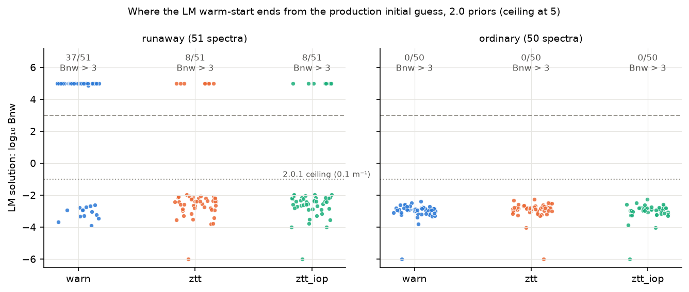
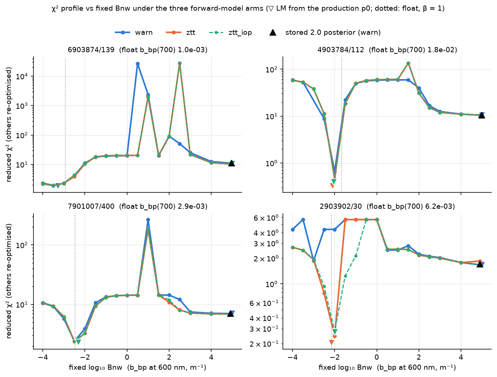
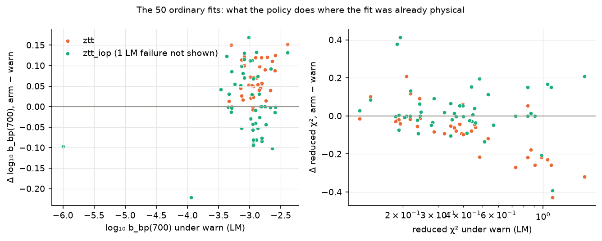
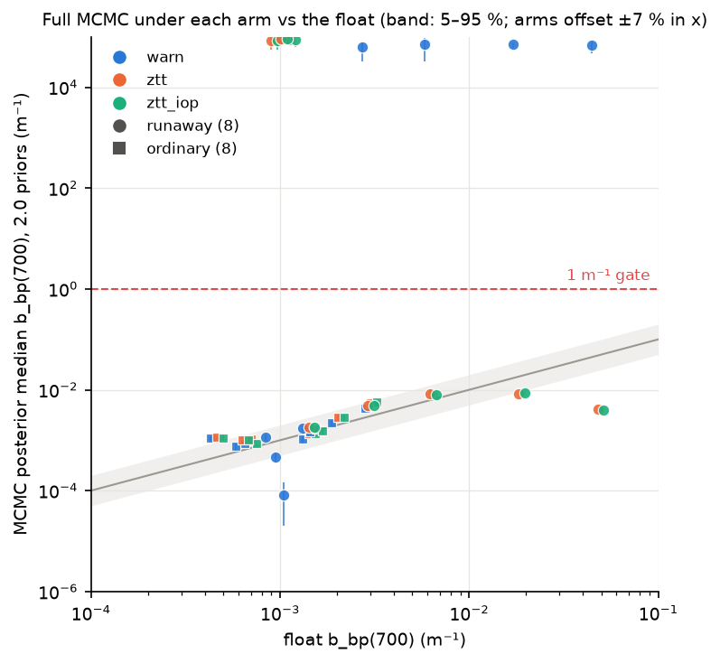

# The emulator out-of-domain slice test (`on_out_of_domain="ztt"`)

*Prompts/Outliers O8, run 2026-10-19 with Fable (Q&A/Outliers 5 = A). A
side experiment on the BING/robust forward model, not a production step:
nothing was written to any database, no chain was persisted under
`$PAB_DATA_DIR`, no BING or robust code was changed — the policy was
installed by monkeypatching at runtime. Script:
[`ztt_slice/run_ztt_slice.py`](ztt_slice/run_ztt_slice.py); the run outputs
(JSON per arm, 48 chains, `summary.md`) are in scratch, not the repo.*

## Summary

- **The `"ztt"` policy, as robust ships it, turns the hybrid into the pure
  analytic ZTT backbone for every PAB pixel.** The packaged emulator's
  training set (L23) has a constant view geometry, so its trained domain for
  `cos θ_v` and `cos Δφ` is `[1, 1]`; every one of the 15,971 fitted pixels
  is off-nadir (θ_v 13.0–60.0°, Δφ anywhere in ±180°), so robust's
  per-sample "any feature out of range" mask is True everywhere and the
  learned correction is zeroed for 100 % of samples. Proven on real inputs:
  the `"ztt"` arm reproduces `mode="ztt"` bit for bit through BING's jitted
  path (§2). The test therefore measures *hybrid vs backbone*, and a third
  arm (`ztt_iop`: the same policy judged on the five learned features only)
  was added to ask the question the prompt meant.
- **The runaway basin is the backbone's, not the emulator's.** Under every
  arm the four report cases keep a physical minimum, a wall at `b_bp`(600)
  ≈ 1–30 m⁻¹ and a plateau descending to the 10⁵ ceiling at the same χ² to
  within ~10 % (§4). The χ² of the stored runaway solutions is 5.9 (median)
  under production and 5.6 under pure ZTT. The policy neither removes the
  basin nor the wall — the 2.0.1 prior ceiling remains the fix.
- **The LM endpoint is path-sensitive and the policy moves it both ways.**
  From the production initial guess under the 2.0 priors, the CPU LM ends at
  the ceiling for **37 of 51** runaways under `"warn"` (§4 saw 3 of 4; O5's
  1 of 4 was the lucky draw), **8 of 51** under `"ztt"`: 32 are rescued, but
  **3 that production-physics finds physical on the CPU run away under the
  backbone** (6903874/139, 4903462/128, 4903489/51 — confirmed by full
  MCMC). `ztt_iop` gives the identical 8.
- **For ordinary fits the policy is not inert.** `"ztt"` moves the LM
  `b_bp`(700) by **+0.055 dex median (16–84 %: +0.011 to +0.119; 14 of 50
  by more than 0.1 dex)** and the full-MCMC median by +0.098 dex (max
  0.136); χ² is essentially unchanged (median Δ −0.05, none worse by > 1).
  Even `ztt_iop` moves 10 of 49 by > 0.1 dex — because **`B_p` leaves the
  emulator's trained range [0.0103, 0.018] in most of the posterior**: the
  `fit_Bp` prior is [0.004, 0.05], the seed 0.01 is already outside, and
  across all 15,971 production fits the posterior-median `B_p` is inside the
  range for only 2,191 (13.7 %). The emulator correction (up to ~18 % of
  Rrs in-domain) is thus switched off over most of the parameter space any
  "ztt"-type policy would act on.
- **Every fit is out of domain, by robust's verdict, at every checkpoint**:
  101 of 101 LM initial guesses and 3 of 3 checks in each of the 48 MCMC
  fits raised `DomainWarning`, each carrying `cos_theta_v`/`cos_dphi`
  "100 % outside [1, 1]"; at the initial guess also `B_p` (0.01 < 0.01026)
  in 101/101 and `log10_u` slightly past −0.428 in 41 of 51 runaways. O6's
  log entry under-counted this ("4 fits"): the O6 log shows the view-geometry
  breach in all 51 warnings.
- **Recommendation to carry to the bing repo (§7):** do not adopt `"ztt"` as
  shipped; expose `on_out_of_domain` through `rt_dict` only together with a
  robust-side fix that excludes constant (unlearned) features from the domain
  check, and treat the `B_p` range and the nadir-only training as the real
  domain questions. PAB keeps `"warn"` and the 2.0.1 ceilings.

## 1. Method

- **Inputs.** The 51 runaways
  ([`high_bbp_outliers/refit_51.csv`](high_bbp_outliers/refit_51.csv)) and
  50 ordinary 2.0 fits drawn with `numpy.random.default_rng(42)` from the
  Outliers-1 300-fit sample list, which survived in
  `/tmp/claude-1000/pab-outliers/chains_sample.txt` (sorted by basename,
  runaways excluded, 50 chosen without replacement). Spectra (`wave`, `Rrs`,
  `varRrs`) from the 2.0 chain NPZs in `$PAB_DATA_DIR/v2/fit_chains/` — the
  O6 replay input; geometry (`theta_s`, `theta_v`, `dphi`) and the Chl seed
  from the v2 database opened `file:…?mode=ro` (`6990528/121`'s negative
  seed passed through, as in production). 10 of the 101 have θ_s > 60°.
- **Arms**, all under `FitConfig.v2_0()` (BING's log-uniform [10⁻⁶, 10⁵]
  priors; no ceiling): `warn` — production; `ztt` —
  `robust.rt.forward = functools.partial(forward, on_out_of_domain="ztt")`
  installed before `bing.evaluate._robust_forward_jit` builds and
  `lru_cache`s its closure (BING looks `forward` up on the `robust.rt`
  module at call time, so rebinding the attribute is enough; the cache is
  cleared when the policy changes), in the parent and in every worker
  initializer, one `spawn` pool per arm; `ztt_iop` — the same, with
  `Emulator.out_of_domain_mask` replaced by the same arithmetic with the
  excess of `cos_theta_v`/`cos_dphi` forced to −∞. The two extra arms are
  monkeypatches confined to the script's processes.
- **Per spectrum and arm.** The LM warm-start exactly as `fit_spectrum` does
  it (`_initial_guess`, prior bounds, `B_p` appended at 0.01,
  `chisq_fit.fit`); χ²_red of p0, of the LM solution and of the stored 2.0
  posterior median under the arm's forward; `emulator.out_of_domain(...)`
  (robust's default θ_s envelope) at p0, at the LM solution and at the
  stored median, through BING's own `_build_robust_inputs` adapter; the
  `DomainWarning` raised by BING's initial-guess check
  (`warnings.catch_warnings(record=True)`; `PYTHONWARNINGS` untouched). For
  the four report cases the §4 χ² profile: `Bnw` fixed on a 17-point grid
  from −4 to 4.9, the other five parameters re-optimised by LM from three
  starts (LM solution, p0, stored median), best χ² kept. For 8 runaways (the
  four report cases, O5's 4903489/51 and 4903462/128, and 1902660/21 and
  4903784/185 drawn with seed 42) and the first 8 of the ordinary draw: the
  full `fit_spectrum` (10,000 + 1,000 steps, 16 walkers), all warnings
  recorded, `chain_start_report`, `out_of_domain` at the posterior median.
- **Run.** Workstation CPU, 8 workers, 2026-10-19 05:24–05:36 PDT: **11 min
  22 s** for the three arms (3.6–3.8 min each, 121 tasks per arm, 0
  failures). After the one-time compile an LM takes 0.25 s, a profile 12–27 s
  and a production-length MCMC 102 s median (108–120 s max). The prompt's
  ~1.5 h estimate assumed O6's 198 s of CPU per fit; the pool was never
  CPU-bound here.

## 2. Proof that the policy is live

`run/proof_of_patch.json`. The packaged emulator's domain
(`load_default().domain`, shape (2, 7)):

| feature | `log10_u` | `eta_bb` = b_bw/b_b | `B_p` | `wave_nm` | `cos θ_s` | `cos θ_v` | `cos Δφ` |
|---|---|---|---|---|---|---|---|
| lo | −3.966 | 0.0176 | **0.01026** | 350 | 0.50 | **1** | **1** |
| hi | −0.428 | 0.966 | **0.0180** | 750 | 1.00 | **1** | **1** |

Synthetic IOPs (a = 0.05 m⁻¹, b_bp = 0.002 m⁻¹: u ≈ 0.05, in domain; or
b_bp = 50 m⁻¹: u → 1, out of domain), `B_p` = 0.014, θ_s = 30°, 400–700 nm:

| case | robust mask | breaches | IOP-only mask | policy output |
|---|---|---|---|---|
| in-domain IOPs, nadir | False | — | False | = hybrid (correction up to 18.5 % of Rrs) |
| in-domain IOPs, θ_v 30°, Δφ 90° | **True** | `cos_theta_v`, `cos_dphi` | False | **= pure ZTT** |
| out-of-domain IOPs, nadir | True | `log10_u`, `eta_bb` | True | = pure ZTT |

On the real runaway 6903874/139 (θ_s 19.7°, θ_v 25.2°, Δφ 11.2°) at its
stored 2.0 posterior median, through `pab.fit.run.reconstruct_rrs` →
`bing.evaluate.calc_Rrs_from_models_robust` → the jitted closure: the `warn`
and `ztt` arms differ by up to 9.4 % of Rrs, and both the `ztt` and the
`ztt_iop` arm equal the un-jitted `mode="ztt"` evaluation of the same inputs
(`allclose`, rtol 10⁻⁵). `ev.robust_rt.forward is robust.rt.forward` holds
after each install.

## 3. Where the LM warm-start ends (all 101, 2.0 priors)

| arm | runaways: at the ceiling (`Bnw` > 4.5) | runaway basin (`Bnw` > 3) | physical (`Bnw` < 0) | LM raised | ordinary in the runaway basin | median χ²_red runaways / ordinary |
|---|---|---|---|---|---|---|
| `warn` | **37/51** | 37/51 | 14/51 | 0 | 0/50 | 4.48 / 0.38 |
| `ztt` | **8/51** | 8/51 | 43/51 | 0 | 0/50 | 0.68 / 0.33 |
| `ztt_iop` | 8/51 | 8/51 | 43/51 | 2 | 0/50 | 0.84 / 0.40 |

Cross-tab `warn` → `ztt` on the 51: runaway in both 5, **rescued 32, newly
runaway 3**, physical in both 11 (identical for `ztt_iop`). The eight still at
the ceiling under `ztt`: 1902683/216, /223, /310 (Baltic), 1902751/19,
4903462/128, 4903489/51 (the all-positive one, `n_neg_blue` 0), 6903874/139,
6903877/215. Every LM in every arm ended either in the physical basin
(`Bnw` −2 to −4; two at the 10⁻⁶ floor) or at the 10⁵ ceiling — there is
nothing between, as Outliers 1 found in the database. χ²_red of the **stored
runaway solution** barely depends on the forward model: median 5.94 (range
0.60–17.4) under `warn`, 5.63 (0.60–17.6) under `ztt` — the runaway basin
is a property of the ZTT saturation limit (§4 of the outliers report), which
the emulator only decorates. The `ztt_iop` LM raised "maximum number of
function evaluations exceeded" for 3 of 101 (6990528/121, 4902620/139,
5906536/108; 0 in the other arms): a per-sample mask makes the forward model
*discontinuous* in `B_p` at 0.01026 and 0.018, and a step inside the
bounded region is exactly what a finite-difference LM stalls on.

## 4. The χ² profile versus fixed `Bnw` for the four report cases

| case | arm | physical minimum (`Bnw`) | wall max (`Bnw`) | plateau at `Bnw` = 4.9 | LM from p0 ends at |
|---|---|---|---|---|---|
| 6903874/139 | `warn` | 1.93 (−3.5) | 2.7×10⁴ (+0.5) | 11.1 | −3.3 (physical) |
|  | `ztt` | 1.90 (−3.5) | 2.0×10³ (+1.0) | 10.4 | **+5.0 (ceiling)** |
| 4903784/112 | `warn` | 0.66 (−2.0) | 59 (+1.5) | 10.5 | +5.0 (ceiling) |
|  | `ztt` | 0.46 (−2.0) | 136 (+1.5) | 10.6 | **−2.1 (physical)** |
| 7901007/400 | `warn` | 2.41 (−2.5) | 266 (+1.0) | 7.0 | +5.0 (ceiling) |
|  | `ztt` | 2.38 (−2.5) | 183 (+1.0) | 6.9 | **−2.3 (physical)** |
| 2903902/30 | `warn` | 1.87 (−2.0) | 5.7 (0.0) | 1.67 (the global minimum) | +5.0 (ceiling) |
|  | `ztt` | **0.24 (−2.0)** | 5.7 (0.0) | 1.85 | **−2.1 (physical)** |

(`ztt_iop` traces `ztt` everywhere except on 2903902/30, where its physical
minimum is 0.28 and the descent into it is slower — the `B_p` step.) **The
wall stays**: in all four cases there is a χ² maximum at `b_bp`(600) ≈
1–30 m⁻¹ (`Bnw` 0 to +1.5) under every arm, within 0.5 dex in position of the
production one; its height is sampled by three LM starts per grid point and is
rough (the 6903874/139 spikes move between +0.5 and +1.0/+2.5), but it never
vanishes. **The basin stays**: the plateau descending to the ceiling is at
the same χ² (within 10 %) under pure ZTT as under the hybrid, so the
`u → 1` saturation limit of the backbone, not the emulator's extrapolation,
is what makes `b_bp` = 10⁵ m⁻¹ an acceptable fit to a blue-depressed
spectrum. **One basin moves**: for 2903902/30 — the `A_ph`-mirror case whose
runaway χ² of 1.67 beat the hybrid's physical minimum of 1.87 — the backbone
fits the physical basin at χ² 0.24, so the global minimum changes sides. The
rescue of three of the four LMs under `ztt` is this kind of effect (a slightly
re-shaped landscape with a different p0 path), not a removed basin — and
6903874/139 goes the other way.

## 5. The 50 ordinary fits and the out-of-domain fraction

| arm | n | Δlog₁₀ `b_bp`(700) vs `warn`, median [16–84 %] | \|Δ\| > 0.1 dex | \|Δ\| > 0.3 dex | Δχ²_red median | χ² worse / better by > 1 | LM raised |
|---|---|---|---|---|---|---|---|
| `ztt` | 50 | **+0.055 [+0.011, +0.119]** | 14/50 | 0 | −0.054 | 0 / 0 | 0 |
| `ztt_iop` | 49 | −0.001 [−0.078, +0.103] | 10/49 | 0 | +0.000 | 0 / 0 | 1 |

Full MCMC on 8 ordinary fits: `ztt` − `warn` posterior-median Δlog₁₀
`b_bp`(700) **+0.098 dex median, max 0.136** (Δχ² −0.02); `ztt_iop`
+0.057 (max 0.130). χ²_red of the stored 2.0 posterior median evaluated
with the backbone is 1.52 (median) against 0.43 with the hybrid, i.e. the
hybrid-vs-ZTT model difference on an ordinary spectrum is ~3× the Rrs noise.
The answer to "≈ 0 if production never leaves the domain in the physical
basin" is therefore **no, by 0.05–0.1 dex**, and for two reasons that are
both domain findings rather than fit findings:

1. **View geometry.** Robust's `out_of_domain` verdict is "out" for 50/50
   ordinary fits at p0, at the LM solution and at the stored posterior median
   (`cos_theta_v`, `cos_dphi` every time), so the shipped `"ztt"` acts on
   every sample. The emulator's prediction does not actually depend on these
   two features — constant training features standardise to exactly 0 — so
   the breach is in the *check*, not in the network's inputs.
2. **`B_p`.** Judged on the five learned features only, **39 of 50** ordinary
   LM solutions are still out of domain: `B_p` 35 (17 below 0.01026, 18
   above 0.018; LM median 0.0150), `cos θ_s` 6 (θ_s > 60°), `eta_bb` 1. At
   the stored 2.0 posterior medians: `B_p` 40 of 50. Within the stored
   posteriors the fraction of samples with `B_p` inside the trained range has
   a median of 0.20 for the ordinary 50 (14 of them below 0.1) and 0.00 for
   the runaways (46 of 51 below 0.1). Over **all 15,971** 2.0 fits (DB,
   read-only): posterior-median `B_p` inside [0.01026, 0.018] for 2,191
   (13.7 %), below for 2,753, above for 11,027; the whole 5–95 % band inside
   for 1 fit, entirely outside for 3,498 (21.9 %).

Out-of-domain fraction at the **ordinary posterior medians** (the 8 MCMC
fits): robust's verdict **8/8** in every arm; IOP features only **8/8**
(`warn`), 7/8 (`ztt`), 6/8 (`ztt_iop`) — `B_p` in every case. For the runaway
posterior medians: 51/51 by `log10_u` and `eta_bb` as well (u → 1).

The `ztt_iop` arm also shows what a per-sample step does to a sampler:
2903451/78's posterior-median χ² is 2.33 under `ztt_iop` against 0.32/0.43
under `ztt`/`warn`, with median `B_p` 0.0101 — on the lower edge of the
trained range, so the median-parameter forward and the bulk of the samples
sit on opposite sides of the switch (acceptance 0.23 vs 0.31–0.36).

## 6. Full MCMC (8 runaways + 8 ordinary × 3 arms)

| case | group | float | 2.0 stored | `warn` | `ztt` | `ztt_iop` |
|---|---|---|---|---|---|---|
| 1902660/21 | runaway | 1.4e-3 | 5.9e4 / χ² 7.8 | 1.75e-3 / 1.46 | 1.81e-3 / 1.35 | 1.81e-3 / 1.35 |
| 2903902/30 | runaway | 6.2e-3 | 7.1e4 / 1.71 | **7.0e4 / 1.71** (wall) | 8.2e-3 / 0.24 | 8.0e-3 / 0.26 |
| 4903462/128 | runaway | 9.0e-4 | 8.7e4 / 9.4 | 1.15e-3 / 1.09 | **8.3e4 / 8.9** (wall) | **8.3e4 / 8.9** |
| 4903489/51 | runaway | 1.1e-3 | 9.0e4 / 11.2 | 8.0e-5 / 0.56 | **8.8e4 / 10.1** (wall) | **8.8e4 / 10.1** |
| 4903784/112 | runaway | 1.8e-2 | 7.2e4 / 10.5 | **7.2e4 / 10.5** (wall) | 8.4e-3 / 0.37 | 8.8e-3 / 0.44 |
| 4903784/185 | runaway | 4.8e-2 | 6.9e4 / 8.5 | **6.9e4 / 8.5** (wall) | 4.1e-3 / 0.76 | 4.0e-3 / 0.76 |
| 6903874/139 | runaway | 1.0e-3 | 9.3e4 / 11.1 | 4.7e-4 / 1.87 | **9.2e4 / 10.4** (wall) | **9.2e4 / 10.4** |
| 7901007/400 | runaway | 2.9e-3 | 6.3e4 / 7.0 | **6.3e4 / 7.0** (wall) | 4.8e-3 / 2.31 | 4.9e-3 / 2.30 |
| 8 ordinary | | | | within 1 % of stored | +0.098 dex median | +0.057 dex median |

(`b_bp`(700) posterior median in m⁻¹ / χ²_red; "wall" = step-0 walker median
`Bnw` > 4.7, chain never below 2.9.) Under `warn` the CPU LM reproduces the
pod's ceiling for 4 of 8 and the production 2.0 values to 1 % where it
does; under `ztt` 5 of 8 land below the gate — 4 rescued, 3 newly lost. The
chains confirm the LM table: where the warm-start ended is where the walker
ball stayed, in every arm. `chain_start_report` is vacuous under `v2_0()`
(no ceilings), as designed. The 2.0.1 re-fit (Appendix C of the outliers
report) lands all 8 physical under the production forward model — the
ceiling does what the policy cannot.

## 7. Question for the bing repo

*Phrased for JXP to carry into `bing` (and `robust`); nothing here changes
either package.*

**Should `on_out_of_domain` be exposed through `rt_dict` / `FitConfig`, and
what should its default be?** The mechanics are easy — `rt_dict_from_p`
would add `rt_dict['on_out_of_domain'] = getattr(p, 'on_out_of_domain',
'warn')`, `_robust_forward_jit` would take it as a fourth `lru_cache` key
and forward it to `robust_rt.forward(...)`, `robust_domain_check` would pass
it too, and PAB's `build_models` would forward a `FitConfig` field through
the factory kwargs like the other RT fields. The evidence says the exposure
is not the issue; the *domain* is:

1. **As shipped, `"ztt"` is `mode="ztt"` for every PACE pixel.** The default
   emulator's `cos_theta_v`/`cos_dphi` domain is `[1, 1]` (L23 is nadir,
   zero azimuth) and `out_of_domain_mask` flags any deviation, divided by the
   `_STD_FLOOR` of 10⁻⁸ ("3.7×10⁹ % of the trained span beyond it" in every
   O6 warning). Every PAB pixel has θ_v 13–60°. So the policy would silently
   discard the emulator for the whole mission while the warning text keeps
   recommending it. **The default must stay `"warn"`** until the check
   excludes features the emulator did not learn from (constant training
   features standardise to 0, so they should not count), i.e. a robust
   change: judge the domain on the learned features only, or carry a
   `learned` mask in the saved `Emulator`. The nadir-only training is itself
   worth stating in BING's `robust_hybrid` docstring: the hybrid has never
   been validated off-nadir, and PAB applies it at θ_v up to 60°.
2. **Even confined to the learned features, the policy would act on most of
   the posterior, through `B_p`.** Trained range [0.01026, 0.018]; BING's
   `fit_Bp` prior [0.004, 0.05] and seed 0.01 (outside); 86 % of production
   posterior medians outside. Three options for the bing repo, in order of
   preference: (a) retrain the emulator over the `B_p` prior range (and more
   than one view geometry) so the domain covers what the sampler explores;
   (b) narrow `BP_PRIOR` to the trained range, accepting that `B_p` then
   mostly measures the emulator's reach; (c) leave both and document that the
   hybrid extrapolates in `B_p` for most fits — the least honest of the three
   but what 2.0 and 2.0.1 did.
3. **A per-sample mask makes the forward model discontinuous.** `ztt_iop`
   stalled the LM on 3 of 101 spectra and put a posterior median on the
   wrong side of the `B_p` switch for one MCMC fit (§5). If a fallback policy
   is wanted inside a fitter, it should blend (a smooth weight on the
   correction as a function of the excess), not switch.
4. **It does not fix the runaways and it is not inert.** The 10⁵ basin and
   the 1–30 m⁻¹ wall belong to the ZTT saturation limit (§4); pure ZTT
   rescues 32 of 51 LM runaways and creates 3 new ones, and shifts ordinary
   `b_bp`(700) by +0.05–0.10 dex with no χ² gain. The prior ceiling (2.0.1)
   is the right fix for the basin; the policy is a model choice with a
   systematic cost.
5. **The initial-guess domain findings (O6, confirmed here).** BING's
   un-jitted checks fire on 100 % of fits, so the warning carries no
   information per fit; the three breaches at the initial guess are (i) the
   view geometry (every fit), (ii) `B_p` seeded at 0.01 just under the
   trained 0.01026 (every fit — a seed of 0.014, the trained mid-range, would
   remove this one), (iii) `log10_u` 6.6 % of bands past −0.428 for the
   blue-depressed spectra (41 of 51 runaways, `u` > 0.37 where the crude
   initial guess puts `b_b` ≈ 0.1 Rrs and `a` ≈ 5 Rrs). Of the 101, 10 have
   θ_s > 60° (`cos θ_s` breach, 9 of them beyond the 1 % tolerance); 8.8 % of
   all fits do (Outliers 1).

**PAB's position until the bing repo answers:** keep `"warn"` (no
`FitConfig` field), keep the 2.0.1 ceilings, and record in the Methods page
that the hybrid emulator is applied off-nadir and outside its `B_p` training
range for most fits (O9 item 4 can carry one sentence). Q&A/Outliers 12–13
ask for the two decisions that are PAB's.

## Appendix — files

- Script (repo): `versions/v2/ztt_slice/run_ztt_slice.py` — `run` (the three
  arms; refuses to run unless `PAB_DATA_DIR` points at scratch) and `analyze`
  (the numbers above as `summary.md`/`summary.json`, the four figures).
- Figures (repo, `versions/v2/ztt_slice/`): `ztt_lm_basins.png`,
  `ztt_profiles.png`, `ztt_ordinary_delta.png`, `ztt_mcmc_vs_float.png`.
- Run outputs (scratch, not committed):
  `/tmp/claude-1000/-mnt-tank-Oceanography-python-PAB/ee4e310b-49d2-41ef-88cf-8177a6e17f0c/scratchpad/o8/run/`
  — `specs.json` (the 101 inputs), `proof_of_patch.json`,
  `results_{warn,ztt,ztt_iop}.json`, `chains/` (48 NPZ, 60 MB),
  `summary.md`, `timing.json`; `run.log` beside it.
- The live v2 database was `9503015b…cad92` before and after; `v1/` untouched;
  nothing written under `$PAB_DATA_DIR`.
